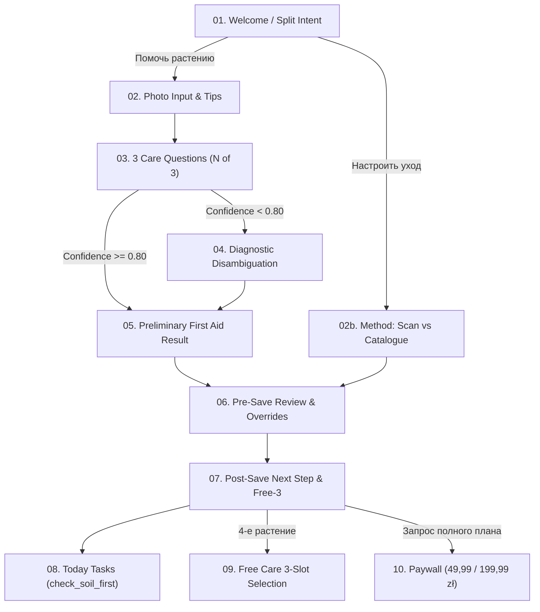

# Narat (iOS MVP) — Комплексный промпт и дизайн-спецификация для Stitch

> Документ сохранён также в артефактах сессии: [stitch_ui_prompts.md](file:///Users/ruslansabirov/.gemini/antigravity/brain/408120e7-5a54-4ef6-85f2-95782b0f1e06/stitch_ui_prompts.md).
> **Назначение документа**: Готовый к отправке промпт и архитектурный гайд для генерации интерактивных макетов, прототипов и дизайн-системы в **Stitch** (Google / UI Generative Tools).
> **Продукт**: Narat — iOS приложение по уходу и диагностике комнатных растений.
> **Целевой рынок**: Польша (PL) и глобальный рынок (EN).
> **Платформа**: iOS 17+, Apple Human Interface Guidelines (SF Pro, iOS Navigation, Dynamic Type, Safe Areas, Dark/Light Mode).

---

## 1. Контекст продукта и ключевые дизайн-принципы

1. **Честный интерфейс без темных паттернов (No Dark Patterns)**:
   - Никаких ложных диагнозов и обещаний «мы обязательно вылечим».
   - Четкое разделение намерений пользователя прямо с первого экрана: **«Помочь растению»** (лечение/проблема) vs **«Настроить уход»** (сохранение/полив).
   - Каталог доступен без сканирования и без расхода квот.
2. **Модель монетизации и квоты**:
   - **Free**: 1 стартовая идентификация + 1 стартовая диагностика (раздельно) до входа. Затем 1 бесплатный анализ в месяц (со следующего UTC месяца).
   - **Free Basic Care**: Базовый уход (проверка грунта, напоминания) строго для **до 3 выбранных растений**.
   - **First Aid**: 1 бесплатное первое действие и контрольная задача на каждый анализ проблемы.
   - **Pro (StoreKit 2, PLN)**:
     - Месячная: `49,99 zł / mies.` (без trial).
     - Годовая: `199,99 zł / rok` (с 7-дневным бесплатным trial для eligible пользователей).
     - 100 фотоанализов в платный период.
     - Ранее полученные планы остаются доступными для чтения даже после истечения подписки.
3. **Визуальная эстетика**:
   - *Natural Tech*: Чистый скандинавско-ботанический минимализм.
   - Цветовая палитра:
     - **Primary (Forest Green)**: `#1E3F20` (Light) / `#2D5E30` (Dark)
     - **Accent (Sage Leaf)**: `#4A7C59`
     - **Background**: `#F9FAF8` (Off-white / Warm Canvas) / `#121413` (Dark)
     - **Surface / Cards**: `#FFFFFF` / `#1C1F1D`
     - **Warning / Stale / Review**: `#D97706` (Warm Amber)
     - **Text Primary**: `#191C1A` / `#E1E3DF`
     - **Text Muted**: `#5C645D` / `#8C938D`
   - Типографика: SF Pro Display (заголовки) / SF Pro Text (основной контент).
   - Скругления: `16pt` для карточек, `24pt` для чипсов и диалогов, `14pt` для системных кнопок.

---

## 2. Карта 10 ключевых экранов для генерации в Stitch



---

## 3. Детальные спецификации экранов

### Экран 01: Welcome & Intent Selection (Первый запуск)
- **Цель**: Дать пользователю немедленную ценность без обязательной регистрации.
- **Компоненты**:
  - Верхний бар: Кнопка «Войти / Log In» (для существующих пользователей, справа вверху).
  - Заголовок: *«Zadbaj o swoje rośliny / Care for your plants»*.
  - Подзаголовок: *«Wybierz, czym chcesz się dzisiaj zająć / Choose what you'd like to do today»*.
  - **Две крупные интерактивные карточки равного веса**:
    1. **«Chcę pomóc roślinie / Help my plant»**:
       - Иконка: Лист со стетоскопом / лупой.
       - Описание: *«Diagnoza problemu, żółte liście, szkodniki i pierwsza pomoc / Diagnose issues, yellow leaves, pests & get first aid»*.
       - Бейдж: *«1 darmowa diagnoza / 1 free diagnosis»*.
    2. **«Chcę ustawić pielęgnację / Set up care»**:
       - Иконка: Лейка / календарь ухода.
       - Описание: *«Podlewanie, rozpoznanie gatunku i darmowe przypomnienia dla 3 roślin / Watering, species recognition & free reminders for 3 plants»*.
       - Бейдж: *«Katalog lub zdjęcie / Catalogue or scan»*.
  - Нижняя сноска: *«Nie wymaga karty płatniczej ani konta / No credit card or account required to start»*.

---

### Экран 02: Подготовка фото и контекстная подсказка (Photo Input)
- **Цель**: Обеспечить качественный кадр (`usable`) и предотвратить размытые/темные снимки.
- **Компоненты**:
  - Видоискатель камеры с пунктирной овальной рамкой и фокус-сеткой.
  - Контекстная подсказка внизу видоискателя:
    - *«Skieruj aparat na całą roślinę oraz zbliżenie na chory liść / Frame the entire plant and close-up on the affected leaf»*.
  - Кнопки: «Zrób zdjęcie / Capture», «Wybierz z galerii / Pick from Gallery».
  - Кнопка замера освещения: *«Zmierz światło / Measure light»*.

---

### Экран 03: 3 базовых вопроса об уходе (Care Questions «N z 3»)
- **Цель**: Собрать реальный контекст ухода без угадывания ИИ.
- **Компоненты**:
  - Прогресс-бар вверху: *«Krok 1 z 3 / Step 1 of 3»*, *«Krok 2 z 3»*, *«Krok 3 z 3»*.
  - Кнопка «Wstecz / Back» с **сохранением введенных ответов и фото**.
  - **Вопрос 1 (Освещение)**:
    - *«Gdzie stoi roślina? / Where is the plant placed?»*.
    - Варианты: *Jasne bezpośrednie / Jasne rozproszone / Półcień / Ciemny kąt / Nie wiem*.
    - Индикатор: Если замеряли камерой — плашка *«Ocena z kamery: Jasne rozproszone (Potwierdź lub zmień)»*.
  - **Вопрос 2 (Полив)**:
    - *«Kiedy ostatnio roślina była podlewana? / When was it last watered?»*.
    - Варианты: *Dzisiaj / 1–3 dni temu / W tym tygodniu / Dawniej niż tydzień temu / Nie wiem*.
  - **Вопрос 3 (Дренаж и горшок)**:
    - *«W czym rośnie roślina? / What pot is it growing in?»*.
    - Варианты: *Doniczka z odpływem / Osłonka bez dziurek / Terakota / Doniczka samonawadniająca / Nie wiem*.

---

### Экран 04: Уточнение диагноза (Diagnostic Disambiguation)
- **Цель**: Если уверенность модели < 0.80 или разрыв между топ-2 кандидатами < 0.10, задать до двух уточняющих вопросов «Да/Нет».
- **Компоненты**:
  - Верхний баннер: *«Potrzebujemy jednego szczegółu, aby potwierdzić diagnozę / We need one detail to confirm diagnosis»*.
  - Карточка вопроса из базы знаний (без галлюцинаций LLM):
    - Например: *«Czy na spodniej stronie liści widać delikatną pajęczynkę? / Can you see fine webbing on the underside of leaves?»*.
  - Два крупных переключателя: **«Tak / Yes»** и **«Nie / No»**.
  - Внизу кнопка: *«Pomiń pytanie (zastosuj bezpieczną obserwację) / Skip question»*.

---

### Экран 05: Предварительный результат первой помощи (Preliminary Result)
- **Цель**: Предоставить бесплатную, безопасную первую помощь без навязывания оплаты.
- **Компоненты**:
  - Статус здоровья: Чипс со статусом (*«Wykryto problem: Przelanie / Root issue detected: Overwatering»* или *«Roślina wygląda na zdrową / Plant appears healthy»*).
  - Вероятная причина и доказательная база (evidence basis):
    - Пункты: *«Żółknięcie dolnych liści», «Ziemia wilgotna od >7 dni»*.
  - Секция **«Pierwsza pomoc (Krok 1) / Immediate First Aid»**:
    - Карточка с зеленым акцентом: *«Wstrzymaj podlewanie i sprawdź drenaż na dnie doniczki»*.
  - Плашка контроля: *«Bezpłatna kontrola za 5 dni (zapiszemy w zadaniach)»*.
  - Главная кнопка действия (CTA): **«Zapisz roślinę i zacznij / Save plant & start»**.
  - Вторичная ссылка: *«Pokaż pełny plan leczenia (wymaga Pro) / View full recovery plan»*.

---

### Экран 06: Проверка перед сохранением (Pre-Save Review & Overrides)
- **Цель**: Позволить пользователю исправить вид, условия, задать имя и комнату до сохранения.
- **Компоненты**:
  - Карточка растения:
    - Фото превью.
    - Название: *«Monstera dziurawa (Monstera deliciosa)»* + кнопка «Zmień gatunek / Change».
    - Поле ввода: *«Własna nazwa (np. Salonowa) / Nickname (optional)»*.
    - Выбор комнаты: Чипсы комнат (*Salon, Sypialnia, Biuro, + Nowy pokój*).
  - Блок подтверждения условий (Care Conditions):
    - Свет: *«Jasne rozproszone (Ocena z kamery)»*.
    - Горшок: *«Z odpływem»*.
    - Полив: *«Umiarkowany»*.
  - Сноска прозрачности: *«Zmiana gatunku lub warunków zaktualizuje plan do najnowszej wersji»*.
  - Кнопка: **«Zapisz w kolekcji / Save to My Plants»** (вызывает вход Apple / Google, если пользователь ещё гость).

---

### Экран 07: Шаг после сохранения (Post-Save Next Step)
- **Цель**: Показать следующее доступное действие на основе `next_available_step`.
- **Компоненты**:
  - Чекбокс успеха: *«Roślina dodana do Twojej kolekcji! / Plant added to collection!»*.
  - **Динамический блок следующего шага**:
    - Если была проблема: Кнопка **«Oznacz wykonanie pierwszej pomocy / Mark first aid done»** + дата следующей проверки.
    - Если уход и есть свободный Free-слот: Кнопка **«Włącz darmowy podstawowy уход (Slot 1 z 3) / Enable Basic Care»**.
    - Если 4-е растение: Кнопка **«Zarządzaj darmową trójką lub odblokuj Pro / Manage Free 3 or unlock Pro»**.
  - Кнопка перехода: **«Przejdź do zadań Dzisiaj / Go to Today tasks»**.

---

### Экран 08: Экран «Сегодня» (Today View)
- **Цель**: Главный рабочий экран ухода на каждый день.
- **Компоненты**:
  - Шапка: Дата (*«Niedziela, 1 listopada»*) и счетчик задач.
  - Секция **«Dzisiaj do zrobienia / Due Today»**:
    - Карточка задачи полива:
      - Иконка капли.
      - Текст: *«Monstera — Sprawdź podłoże przed podlaniem / Check soil first»*.
      - Бейдж правила: `check_soil_first` (не безусловный полив!).
      - Кнопка в 1 тап: *«Podlane dzisiaj / Done»*.
      - Меню «три точки»: *«Zmień datę / Przełóż na jutro / Nie wymaga podlewania»*.
    - Карточка задачи контроля первой помощи:
      - Иконка бинта / лупы: *«Fikus — Kontrola po 5 dniach (zrób zdjęcie)»*.
    - Бейдж `needs_review` (если менялись условия):
      - Янтарная плашка: *«Warunki rośliny uległy zmianie — sprawdź zalecenia (możesz oznaczyć wykonanie)»*.
  - Состояние «Пустой день» (Empty State):
    - Иллюстрация листа в покое.
    - Текст: *«Wszystkie rośliny zaopiekowane na dzisiaj. Najbliższa kontrola: czwartek, 5 listopada. / All plants cared for today. Next check: Thursday.»*.

---

### Экран 09: Управление бесплатной тройкой ухода (Free Care 3-Slot Selection)
- **Цель**: Дать прозрачный контроль над 3 бесплатными слотами базового ухода при добавлении 4-й или последующих растений.
- **Компоненты**:
  - Заголовок: *«Darmowa opieka dla 3 roślin / Free care for 3 plants»*.
  - Описание: *«Podstawowy harmonogram, przypomnienia i historia są darmowe dla maksymalnie 3 wybranych roślin. Możesz w każdej chwili zmienić wybór bez utraty historii. / Basic care is free for up to 3 selected plants.»*.
  - Список растений пользователя с радио-чекбоксами (максимум 3 активных):
    - `[✓]` Monstera dziurawa (Slot 1)
    - `[✓]` Sansewieria (Slot 2)
    - `[✓]` Fikus Benjamina (Slot 3)
    - `[ ]` Skrzydłokwiat (Poza darmowym pakietem — historia zachowana, przypomnienia wstrzymane)
  - Кнопка: **«Zapisz wybór / Save selection»**.
  - Баннер внизу: *«Chcesz nielimitowany uход dla wszystkich roślin? Wypróbuj Narat Pro / Want unlimited care for all plants? Try Narat Pro»*.

---

### Экран 10: Экран подписки Narat Pro (Paywall)
- **Цель**: Конверсия без навязывания, строго в контексте запроса расширенной функции (полный план, >3 растений, follow-up).
- **Компоненты**:
  - Кнопка закрытия `✕` (всегда доступна в левом верхнем углу, возвращает к Free-режиму).
  - Заголовок: *«Odblokuj pełny potencjał Narat Pro / Unlock full Narat Pro»*.
  - Пункты ценности:
    - *«100 analiz i diagnoz AI miesięcznie (zamiast 1) / 100 AI analyses per month»*.
    - *«Nielimitowane rośliny w harmonogramie (zamiast 3) / Unlimited plants in care schedule»*.
    - *«Pełne plany regeneracji z dawkowaniem i preparatami z polskich sklepów / Full recovery plans with Polish market products»*.
    - *«Śledzenie postępów i porównywanie zdjęć / Follow-up photo comparison»*.
  - **Два тарифа в польских злотых (PLN)**:
    1. **Roczny (Polecany) / Yearly**:
       - *«199,99 zł / rok (16,66 zł / mies.)»*.
       - Бейдж: *«7 dni za darmo (dla nowych użytkowników) / 7 days free trial»*.
       - Переключатель напоминания: *«Przypomnij mi 24h przed końcem okresu próbnego / Remind me 24h before trial ends»* (toggle opt-in).
    2. **Miesięczny / Monthly**:
       - *«49,99 zł / miesiąc»*.
       - Подпись: *«Bez okresu próbnego, anuluj w każdej chwili / No trial, cancel anytime»*.
  - Главная кнопка: **«Rozpocznij 7 dni za darmo / Start 7 days free»** (или «Subskrybuj / Subscribe»).
  - Ссылка: *«Przywróć zakupy / Restore Purchases»* | *«Regulamin i Prywatność / Terms & Privacy»*.

---

## 4. Готовый мастер-промпт для копирования в Stitch

Ниже приведен готовый целостный промпт на английском языке, оптимизированный для быстрой генерации полного макета в Stitch:

```text
Design a cohesive, production-grade iOS 17 mobile app UI flow called "Narat" — a houseplant diagnosis and smart plant care application localized for Poland and international users.

Visual Style:
- Clean, Nordic-botanical minimalism ("Natural Tech").
- Palette: Deep Forest Green (#1E3F20), Fresh Sage (#4A7C59), Warm Canvas background (#F9FAF8), Surface Pure White (#FFFFFF), Warm Warning Amber (#D97706), Dark Text (#191C1A), Muted Text (#5C645D).
- Apple Human Interface Guidelines: SF Pro font family, native navigation bars, sheet modals, rounded corners (16pt cards, 24pt pill badges, 14pt primary buttons), generous touch targets (min 44pt).

Generate the following 10 interconnected screens:

1. WELCOME & INTENT SCREEN:
   - Header with subtle "Sign In" link for returning users.
   - Headline: "Zadbaj o swoje rośliny" (Care for your plants).
   - Two equal-prominence hero cards:
     Card A: "Chcę pomóc roślinie" (Help my plant) with diagnostic leaf icon, badge "1 darmowa diagnoza" (1 free diagnosis).
     Card B: "Chcę ustawić pielęgnację" (Set up care) with watering can icon, badge "Katalog lub zdjęcie" (Catalogue or scan).
   - Subtext: "Nie wymaga karty ani konta do pierwszego wyniku" (No credit card or account needed to start).

2. CAMERA INPUT & LIGHT PROBE:
   - Live camera viewfinder with plant silhouette guidance box.
   - Context tooltip: "Skieruj aparat na całą roślinę i chory liść" (Frame whole plant & affected leaf).
   - Shutter button, gallery picker, and a "Measure Light" sensor button.

3. 3-STEP CARE QUESTIONS ("Krok N z 3"):
   - Step progress indicator (1 of 3, 2 of 3, 3 of 3) with back button that preserves answers.
   - Question cards: Light placement, watering history, and pot drainage type.
   - Every question must include an "I don't know" (Nie wiem) pill button.
   - Light question shows "Camera estimate: Bright indirect (Confirm or change)" badge.

4. DIAGNOSTIC DISAMBIGUATION MODAL:
   - Shown when model confidence < 0.80.
   - Friendly banner: "Potrzebujemy jednego szczegółu, aby potwierdzić diagnozę".
   - Clear binary question card (e.g., "Are there fine webs on the leaf undersides?").
   - Two large buttons "Tak" (Yes) and "Nie" (No), plus a secondary "Pomiń pytanie" (Skip question).

5. PRELIMINARY FIRST AID RESULT:
   - Plant status chip: "Wykryto problem: Przelanie" (Root issue: Overwatering) with evidence bullets.
   - Prominent green First Aid Action card: "Immediate step: Cease watering, inspect drainage".
   - Free follow-up control badge: "Darmowa kontrola za 5 dni".
   - Primary CTA: "Zapisz roślinę i zacznij" (Save plant & start). Secondary text link: "Pokaż pełny plan leczenia".

6. PRE-SAVE REVIEW & EDIT:
   - Plant card with photo thumbnail, confirmed species name with "Change" button, optional nickname and room selector chips.
   - Care conditions summary pills (Light, Pot, Watering).
   - Button: "Zapisz w kolekcji" (Triggers Sign in with Apple / Google sheet).

7. POST-SAVE NEXT STEP:
   - Success checkmark: "Roślina dodana do Twojej kolekcji!".
   - Action card showing exact next available step: "Oznacz wykonanie pierwszej pomocy" or "Włącz darmowy uход (Slot 1 z 3)".
   - Primary button: "Przejdź do zadań Dzisiaj".

8. "TODAY" TASKS SCREEN (Main Home):
   - Date header with pending tasks badge.
   - Task Card 1: Watering task with mandatory "Sprawdź podłoże przed podlaniem" (check soil first) badge. 1-tap complete button.
   - Task Card 2: First-aid check task with camera icon.
   - Task Card 3: Task with amber "needs_review" badge (conditions changed, tap to view or complete).
   - Empty state illustration for "All plants cared for today".

9. FREE CARE 3-SLOT SELECTION SCREEN:
   - Explains that basic care reminders are free for up to 3 chosen plants.
   - Interactive list with checkboxes for 4+ plants (3 selected, 1 unselected with notice: "History saved, reminders paused").
   - Primary CTA: "Zapisz wybór". Bottom banner: "Want unlimited care? Try Narat Pro".

10. NARAT PRO PAYWALL:
    - Close button (✕) always visible in top-left corner.
    - Title: "Odblokuj pełny potencjał Narat Pro".
    - Benefit bullets: 100 AI scans/month, unlimited plants in care schedule, full recovery plans with Polish market products.
    - Two pricing cards in PLN:
      - Yearly: "199,99 zł / rok (16,66 zł/mies.)" with "7 dni za darmo" badge and "Przypomnij 24h przed końcem" toggle.
      - Monthly: "49,99 zł / miesiąc" (No trial, cancel anytime).
    - Primary CTA: "Rozpocznij 7 dni za darmo". Footer with Restore Purchases and Terms.
```
