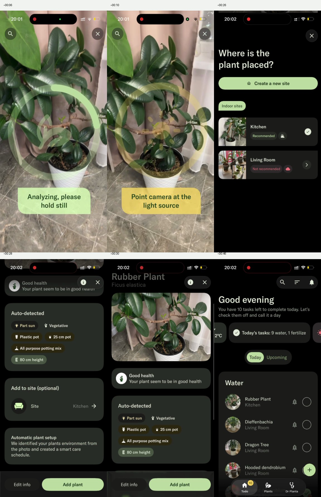

# Planta: добавление растения и выводы для Plants MVP

Источник: предоставленная запись `IMG_0470 (1).MP4`, 48 секунд. Дата разбора: 20 октября 2026. Таймкоды приблизительные, точность около двух секунд.

Анализ относится к показанному проходу в приложении с уже существующими растениями и комнатами. Первый запуск, подписка и точность распознавания не проверены. Спецификация MVP не изменялась.

## Главный вывод

Planta быстро переводит добавление растения в настроенный уход: **распознавание → оценка света → проверка карточки → добавление → первая задача**. Полезнее всего взять экран подтверждения данных и понятный результат добавления. Автоматическое заполнение условий требует отдельной проверки качества.

## Что видно в записи

| Время | Наблюдение | Значение для нашего MVP |
|---|---|---|
| 00:00–00:04 | Список задач, затем меню «+» с Add plant, Add site, задачами и справочными действиями. | Добавление доступно из главного экрана. Столь широкое меню нам пока не требуется. |
| 00:04–00:10 | Камера на растении, «Analyzing, please hold still», затем «Identification completed». | Короткая инструкция объясняет необходимое действие; завершение этапа явно подтверждено. |
| 00:10–00:15 | Подсказка «Point camera at the light source», пользователь переводит камеру на окно; «Light analysis, completed». | Условия собираются в контексте съёмки. Это не доказывает точность оценки или её пригодность для обычного режима освещения. |
| 00:15–00:23 | «Planta at work», индикатор ожидания, затем превью с Redo / Use. | Есть возможность повторить этап. Механика обработки и смысл процентов/прогресса по записи неизвестны. |
| 00:23–00:30 | Карточка растения, Good health, блок Auto-detected, необязательная комната; отдельный выбор Kitchen / Living Room с Recommended / Not recommended. | Результаты собраны для проверки до сохранения. Объяснение рекомендаций комнат в кадре не показано. |
| 00:30–00:39 | Rubber Plant / Ficus elastica, фото, параметры, закреплённые Edit info и Add plant. | Пользователь подтверждает конкретную карточку; возможность исправления заметна. Само редактирование не открывают. |
| 00:39–00:44 | Сообщение о подготовке плана ухода. | Добавление связано с дальнейшей пользой, а не только с сохранением фото. |
| 00:44–00:48 | В сегодняшнем Water появляется Rubber Plant, Kitchen. | Результат виден в основном интерфейсе. Выполнение задачи и её условия в записи не открывают. |

В блоке Auto-detected перечислены: Part sun, Vegetative, Plastic pot, 25 cm pot, All purpose potting mix, 80 cm height. Интерфейс называет их автоопределёнными; запись не позволяет установить, получены ли они из изображения, предыдущих настроек, справочника или значений по умолчанию.

## Что полезно взять сейчас

1. **Два понятных намерения при добавлении.** «Добавить растение» и «Помочь больному растению». В нашей спецификации уже есть каталог без диагностики и анализ по фото; стоит ясно объяснить разницу в интерфейсе. В записи Planta показывает сценарий обычного ухода.
2. **Карточка подтверждения перед сохранением.** Фото при наличии, вид, комната, известные условия и кнопка исправления. Если пользователь выбрал вид из каталога, не заставлять его добавлять фото. Неизвестные данные обозначать явно.
3. **Комната — необязательный короткий шаг.** Выбрать существующую или создать новую из того же экрана. Не блокировать добавление из-за отсутствия комнаты.
4. **Инструкция непосредственно в нужный момент.** Вместо отдельного обучения — короткая подсказка в камере. Для нашей приблизительной оценки света сохранить ручной выбор, «не знаю» и возможность пропустить измерение.
5. **Видимый итог добавления.** Показать сохранённое растение и следующий доступный шаг. С подпиской — переход к задачам подтверждённого плана; без подписки — сохранённая карточка и предложение полного ухода. Автоматически выдавать задачи всем противоречило бы нашему FR-023.

## Что не переносить буквально

- **Непроверенные точные параметры.** Значения «25 см», «80 см», конкретный грунт выглядят убедительно. У нас стоит различать ответ пользователя, приблизительную оценку и неизвестное значение; не выдавать предположение за установленный факт.
- **Немедленный безусловный полив.** После добавления растение появляется в сегодняшнем Water, но вопроса о последнем поливе в показанном проходе нет. Это не доказывает ошибку Planta: данные могли быть известны ранее. В нашем MVP первая задача должна сохранять условие проверки грунта, уже предусмотренное моделью данных.
- **Рекомендацию комнаты без объяснения.** Для полезного Recommended нужны сведения об условиях комнаты и понятное основание. Сейчас наша комната — группа растений; превращать её в профиль микроклимата только ради такого бейджа не стоит.
- **Впечатление точного измерения света.** Подсказка направить камеру на окно — UX-приём, а не подтверждение метода измерения. Наш FR-034 уже требует приблизительной категории и ручного исправления.
- **Лишние возможности в меню добавления.** Совместный уход, произвольные задачи и справочные инструменты не обязательны для основного сценария MVP.

## Отличие от PlantIn

| | PlantIn в предыдущей записи | Planta в этой записи |
|---|---|---|
| Намерение | Разобраться с проблемой растения | Добавить растение и настроить обычный уход |
| Сбор данных | Общий и крупный снимки, шесть вопросов | Камера на растении и источнике света; предварительно заполненная карточка |
| Основной CTA | «Сохранить и Лечить» | Add plant |
| Продолжение | План и срок проверки здоровья | Новое растение в сегодняшних задачах |
| Полезный урок | Связать диагноз с действием и контролем | Упростить настройку и дать проверить данные до сохранения |

Нельзя заключить, что автоматический сценарий Planta точнее или лучше конвертирует: это разные намерения, по одному проходу в каждом приложении.

## Рекомендуемый путь для нашего MVP

**Добавить → выбрать вид из каталога или пройти анализ по фото → проверить вид и условия → необязательно выбрать комнату → сохранить → предложить/открыть полный план по праву доступа.**

Для каталожного пути диагностика и фото не обязательны. Для диагностики остаются согласованные три вопроса. Автоматические подсказки могут помогать ответить, но не должны незаметно заменять ответы. Экран проверки можно объединить с сохранением результата, не вводя ещё один обязательный экран.

В дизайн сейчас стоит внести: понятные точки входа, проверку данных, необязательную комнату и явный итог сохранения. Рекомендации комнат и определение размеров/грунта оставить за пределами MVP до подтверждения необходимости и качества.

Проверить на пользователях: различают ли они добавление и диагностику; замечают ли ошибку в предварительно заполненной карточке; понимают ли, что сделать после сохранения. Сравнить время и завершение каталожного добавления без фото, а не использовать 48 секунд записи как норматив.

Основание: [спецификация MVP](../../../specs/001-plants-ios-mvp/spec.md), US2, US3, FR-023, FR-031, FR-034; [модель данных](../../../specs/001-plants-ios-mvp/data-model.md), условия содержания и условное выполнение полива.
