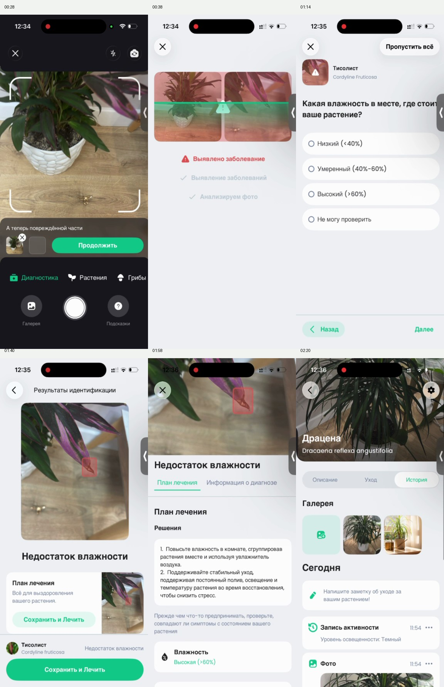

# PlantIn: разбор диагностики и выводы для Plants MVP

Источник: предоставленная запись `IMG_0461.MP4`, 3:44. Таймкоды приблизительные, с шагом просмотра 2 секунды. Дата разбора: 20 октября 2026.

Это анализ показанного сценария и интерфейса. Один проход не позволяет оценить точность диагностики, конверсию, удержание или условия подписки. Спецификация MVP не изменялась.

## Главный вывод

Полезнее всего перенять связку **диагностика → действие → контроль состояния**. У нас она уже предусмотрена. Видео помогает уточнить подачу результата и сбор данных, но не обосновывает расширение MVP до всей функциональности PlantIn.

## Что происходит в записи

| Время | Наблюдение | Вывод для MVP |
|---|---|---|
| 00:00–00:18 | Старт из существующего списка задач. Камера доступна в нижней навигации. | Диагностику удобно запускать повторно из основного интерфейса. Это не запись первого запуска. |
| 00:18–00:32 | В камере выбирают «Диагностика». Сначала подсказка снять всё растение, затем повреждённые части. Пользователь делает два снимка. | Общий вид и крупный план дают разный контекст. После первого снимка уже видна кнопка «Продолжить»; обязательность второго фото по записи не установлена. |
| 00:32–00:40 | Сканирующая анимация, этапы анализа, затем красное сообщение «Выявлено заболевание». | Этапы делают ожидание понятным. Но предупреждение появляется до вопросов об уходе. |
| 00:40–01:38 | Шесть вопросов; сверху определённое растение «Тисолист / Cordyline Fruticosa» и значок редактирования. | Вид полезно показывать до результата с возможностью исправления. Само редактирование в записи не проверяется. |
| 01:38–01:50 | Результат «Недостаток влажности», фото с красной отметкой, основной CTA «Сохранить и Лечить», дополнительный вход в ИИ-советы. | Основное действие хорошо заметно. Первое конкретное действие по уходу на этом экране не показано. |
| 01:50–02:00 | Короткое создание плана. В плане — решения, целевая влажность, проверка здоровья через две недели; сообщение об обновлении настроек ухода. | План связывают с дальнейшим уходом. Автоматическое создание конкретных задач для этого растения в записи полностью не проверено. |
| 02:00–03:44 | Возврат в задачи, просмотр карточки драцены, истории, фото, справочника и FAQ; в конце — лента. | Есть развитый сценарий после диагностики. Просматриваемая драцена отличается от диагностированного тисолиста: нельзя приписывать ей результат нового анализа. |

От открытия камеры до результата проходит около 80 секунд **в этом проходе**. Значительная часть времени — ответы и паузы пользователя; это не замер скорости модели или среднего времени прохождения.

## Вопросы PlantIn

1. Частота полива — от каждых 1–2 дней до раза в месяц.
2. Недавний перепад температуры — повышение / понижение / без изменений.
3. Освещение — тень / полутень / яркое солнце.
4. Влажность воздуха — три диапазона и «Не могу проверить».
5. Частота удобрения — от каждых 1–2 недель до «Никогда».
6. Попадает ли вода на листья во время полива — да / нет.

На последующих экранах видны «Назад», «Далее» и «Пропустить всё». Индикатора оставшегося количества вопросов не видно. На первом вопросе запись долго остаётся без выбранного ответа; причина паузы неизвестна.

## Что стоит взять

- **Подсказки при съёмке.** Объяснять, что должно попасть в кадр. Второй снимок запрашивать при недостатке данных; сделать его обязательным означало бы изменить текущий FR-002.
- **Растение как контекст диагностики.** Показывать распознанный вид и явную неопределённость. Проверить удобство исправления вида до формирования плана.
- **Один основной следующий шаг.** У нас первый экран результата должен сразу содержать бесплатное первое действие с объяснением, как уже требует FR-005.
- **Срок проверки рядом с планом.** Пользователю нужно понимать, когда вернуться и что оценивать. Контрольное фото должно продолжать историю того же экземпляра — это уже заложено в US6.
- **Подробности по запросу.** Короткое решение на первом экране; объяснения и справка раскрываются отдельно. Видеоуроки и большая энциклопедия для этого не обязательны.

## Что не стоит повторять

- **Уверенное «выявлено заболевание» до уточнения условий.** Итоговая формулировка «Недостаток влажности» сама по себе не доказывает заболевание. Для нашего интерфейса лучше нейтральное «Уточним возможную причину», затем вероятный вывод с ограничениями.
- **Слабую связь собранных данных с выводом.** В вопросе о влажности есть «Не могу проверить», но в результате не показано, какие наблюдения и ответы поддерживают вывод. Это не доказывает ошибочность диагноза; интерфейс не объясняет, почему выбран именно он. Выбранный ответ на этот вопрос по просмотренным кадрам не подтверждён.
- **Вопросы, требующие измерений, без удобного выхода.** Наше «не знаю» для каждого из трёх вопросов — полезное решение. Количество вопросов PlantIn не подтверждает их диагностическую ценность.
- **Размытый первый результат.** Диагноз и предложение открыть лечение не заменяют ответ «что сделать сейчас».
- **Перегрузку первого сценария.** В кадре есть грибы, AR, ИИ-советы, лента, FAQ и обучающие видео. Их наличие не является основанием добавлять их в MVP.

## Рекомендация по нашему флоу

**Одно фото с подсказкой → три вопроса с «не знаю» → вероятная причина + первое действие → сохранение → предложение полного плана → задачи и контрольное фото.**

Сохранить текущие три обязательных вопроса: свет, полив, дренаж. Из записи нельзя заключить, что шесть вопросов PlantIn дают более точный результат. Состав вопросов проверяется на диагностической выборке, а удобство — отдельно на пользователях.

Кандидаты для уточнения дизайна без расширения обязательного пути:

| Приоритет | Предложение | Проверка |
|---|---|---|
| Сейчас | Подсказка для общего фото; формулировки «Шаг 1 из 3» и «Не знаю» | Пользователь понимает, что снять и сколько осталось шагов. |
| Сейчас | На результате: вероятная причина, основание, первое действие и понятный следующий шаг | Пользователь своими словами объясняет, что сделать и почему. |
| Сейчас | В полном плане — действие, срок/условие выполнения, критерий повторной проверки | Пользователь понимает, когда и с чем вернуться. |
| Проверить | Необязательный крупный план при недостатке данных | Сравнить пользу для диагностики с дополнительным временем и отказами; внедрение потребует согласования артефактов. |
| Позже | Дополнительные вопросы по конкретной гипотезе, справочник, ИИ-чат | Добавлять при подтверждённой необходимости; шесть обязательных вопросов из видео не копировать. |

Новые гипотезы: подсказка улучшает пригодность фото; объяснение основания повышает понимание результата; явная дата проверки помогает вернуться. Видео не подтверждает эти эффекты — их нужно проверить. Наши критерии SC-001–004 уже задают основу: скорость получения помощи, качество определения и пригодность первого действия.

## Что осталось неизвестным

- Первый запуск, регистрация, paywall, бесплатные лимиты и статус подписки пользователя: в записи не показаны.
- Обязателен ли второй снимок и как работает сценарий с одним: пользователь его не проходит.
- Как ответы меняют диагноз, что происходит при плохом фото и исправлении вида: не проверено.
- Сохранился ли новый экземпляр и как именно появились его задачи: есть CTA и сообщение об обновлении, но полного подтверждения связей нет.
- Точность диагноза и эффективность назначенного плана: по интерфейсу установить нельзя.

Основание для сопоставления: [спецификация MVP](../../../specs/001-plants-ios-mvp/spec.md), прежде всего US1, US3, US6, FR-002–007, A-002 и SC-001–004.
