# Knowledge Base Pipeline — уход и диагностика

> **Синхронизация 2026-11-01:** технический дизайн приведён к спецификации Narat
> от 2026-10-30 и конституции 3.0.0: 68 FR, 25 SC, 9 историй.
> Это проект реализации; код, данные, интеграции и приёмочные испытания ещё не выполнены.

**Дата**: 2026-10-25 · **Статус**: архитектура согласована поручением владельца; данные и пайплайн ещё не созданы.
**Основание**: [spec.md](spec.md), FR-052–FR-064, SC-016–SC-020; конституция v3.0.0; проекции Free/контроля согласованы с FR-023/065/066.

## 1. Граница изменения

MVP использует Hybrid AI + Golden Records: офлайн собираем версионную базу
фактов ухода для существующих 606 видов и отдельных протоколов для 40 канонических проблем;
в приложении Vision только классифицирует вид, симптомы, возможные проблемы
и изменения на контрольном фото. Первая помощь, объяснения, обычный уход,
планы восстановления и правила задач выбираются из опубликованной базы.
Генерация новых советов и лечебных протоколов LLM в рантайме запрещена.

Специалист не является обязательной зависимостью MVP. Golden означает прохождение
проверок происхождения, согласованности, схемы и правил, а не экспертную сертификацию.
Согласие нескольких LLM не считается независимым подтверждением факта.
Владелец выпуска проверяет отчёт публикации; ботаническая квалификация не требуется.
Неопределённые и противоречивые данные остаются в карантине, а не заполняются догадками.

Это решение заменяет прежние ~200 видов, обязательный экспертный eval,
отключённую токсичность и AI-генерацию recovery plan. Сохраняются три базовых вопроса
об уходе, а после анализа при необходимости — ещё 1–2 уточняющих вопроса.
Доступ соответствует FR-065/023/066: два starter, Free monthly=1, paid/trial monthly=100;
Free basic для трёх растений и один контроль первой помощи. Новые full планы/premium задачи требуют paid access; прежние планы читаются после expiry. Сохраняются локальные уведомления
UserNotifications. Слово Push здесь означает пользовательские напоминания;
отдельный APNs backend в MVP не добавляется.

## 2. Два контура

```mermaid
flowchart LR
  S[Каталог 606 видов] --> D[Разрешённые доноры: Markdown + provenance]
  D --> Y[Offline LLM synthesis + schema + guardrails]
  Y --> L[EN / PL + market mapping]
  L --> Q[Проверки / карантин / отчёт]
  Q --> K[(Неизменяемый KB release)]
  P[Фото + подтверждённые условия] --> V[Vision: plant_id / condition_id / признаки]
  K --> V
  V --> C[Валидация ID и применимости]
  K --> C
  C --> QD[До 2 вопросов из ConditionProfile]
  QD --> DR[Детерминированное уточнение]
  DR --> R[ProtocolResolver + PlanService]
  R --> T[SQL ScheduleCalculator]
  T --> I[iOS: задачи и локальные уведомления]
```

Первый запуск создаёт полный релиз один раз. Последующие запуски — явные
инкрементальные обновления по изменённым источникам; не сбор веб-страниц на каждый
запрос пользователя. Личные фото не попадают в офлайн-корпус автоматически.
Offline ключи/бюджет отделены от runtime provider_daily_budget и пользовательских квот.

## 3. Реестр доноров

Это целевые источники по поручению владельца, а не подтверждение доступности
выгрузки, права на scraping или достаточности покрытия на 2026 год.

| Роль | Доноры | Требование к использованию |
| --- | --- | --- |
| Таксономия, базовые параметры | Perenual API, RHS, NC State Extension Plant Toolbox | Сверка научного имени, ранга и семейства; Perenual ID — внешний идентификатор |
| Токсичность для животных | ASPCA Toxic and Non-Toxic Plants | Точный таксон, отдельно cat/dog, исходный статус и область применимости |
| Практический квартирный уход | House Plant Journal (Darryl Cheng), PLNTS.com, Patch Plants, The Sill | FC, условия измерения, субстраты и аэрация только с происхождением конкретного факта |
| Симптомы, причины, действия | Penn State Extension, UMN “What's wrong with my plant?”, University of Maryland Extension, Clemson HGIC | Основные независимые основания диагностических протоколов |
| Практическая диагностика и биозащита | PLNTS Doctor, Koppert, Biobest | Дополнительные признаки, совместимость и условия применения; реклама не подтверждает эффективность |
| Польская регистрация и применение | MRiRW: реестр, действующая этикетка, решения | Источник проверки допустимости конкретного применения |
| Предложение в Польше | Allegro, Castorama, Leroy Merlin | Только наличие/ссылка/дата; не источник разрешения применения |

Прежние WFO/Wikidata остаются дополнительными источниками сверки таксономии/названий,
Commons — разрешённых иллюстраций. Они не заменяют доноров ухода и диагностики.

До сетевого ingestion у каждого донора в `source_registry` фиксируются URL/endpoint,
условия API/сайта, основание коммерческого использования, разрешение автоматического
сбора, хранения, LLM-обработки и производных данных, атрибуция, лимиты и дата проверки.
Статусы: `candidate / allowed / blocked / expired`. Работает только `allowed`.
Robots.txt соблюдается, но сам по себе не даёт прав. Публичность страницы, платный API
и перефразирование текста не доказывают права на хранение/переиспользование.
Запреты/403/paywall не обходятся; донор исключается, нужные записи блокируются по покрытию.
Материалы и фото могут иметь разные лицензии. Автоматическая проверка прав
не подменяется ответом LLM. Неизвестные права означают запрет ingestion до разрешения.

## 4. Четыре этапа

### Stage 1 — Seed & Taxonomy Normalization

Seed для обогащения — 606 устойчивых ID из существующего каталога. Покрытие оценивается отдельно по каждому действию и сезону по SC-016.
Синонимы связываются на уровне конкретных видов: Sansevieria → принятый Dracaena,
Calathea → Goeppertia только при подтверждённом таксономическом соответствии;
глобальная замена рода строкой запрещена. Неоднозначные совпадения — в карантин.

`plant_id` — стабильный семантический ключ (`monstera_deliciosa`), отдельно от UUID
личного экземпляра `plants.id`. Он однозначно связан с каталоговым `taxon_id` UUID;
переименования не меняют ключ, используются aliases/redirects. Сорта — квалификаторы,
не дополнительные виды для достижения числа 300.

Базовый каталог видов (`catalogue_releases` с `kb_release_id = null`, релиз `skeleton-300-v1` на 606 коммерческих видов) публикуется и обслуживается независимо от публикации отдельных фактов ухода и протоколов диагностики. Он сразу поставляет проверенную таксономию (Wikidata/WFO/GBIF/IPNI/POWO), описания на английском и польском (`descriptions.en` и `descriptions.pl` с атрибуцией CC BY-SA 4.0 и `source_revision`), обиходные названия и синонимы (`common_names`, `search_aliases`, `taxon_names`), локально проверенные видовые фотографии из Wikimedia Commons (`hero_image` / `catalogue_media`) и базовые сезонные интервалы полива (`watering`), позволяя искать виды, открывать карточку вида и сохранять растение в коллекцию до публикации `care_profiles` и `condition_profiles`. Факты по каждому действию и применимые протоколы подключаются на следующих этапах по тому же стабильному `plant_id` / `taxon_id`.

Импорт базового каталога и публикация используют одну [JSON-схему](contracts/catalogue-skeleton.schema.json): `definitions.record` для входа, `definitions.card` для публичного DTO. Копия схемы в SQL поддерживается `knowledge-base/pipeline/sync_catalogue_schema.py` (`--check` обнаруживает расхождение). Импорт и переключение релиза берут транзакционную advisory-блокировку `public.catalogue_releases_mutex` до блокировки строки релиза, затем вида; прямые изменения `catalogue_releases` берут ту же блокировку в BEFORE STATEMENT. Снимки валидируются при записи и повторно при активации; ошибка откатывает переключение. `watering.intervals_days` содержит все 4 сезона, каждый — целое 1..365 либо null. Null не задаёт расписание; минимум 2 числовых сезона, кроме `immersion` (допустимы все null). Настоящий pgTAP, проверку 606 SQL/TS-проекций EN/PL и конкурентные сценарии запускает `supabase/tests/run_catalogue_regression.py` на PostgreSQL >=15 в отдельной временной БД.

Привязывается ASPCA safety с точным taxon и cat/dog. `is_toxic_to_pets` допускает
true/false/null: true при известном риске хотя бы для одного из этих животных;
false только при явном non-toxic для обоих; иначе null. Нет записи ≠ non-toxic.
`toxin_type` и `severity` не выводятся моделью из общего описания: при отсутствии
прямого основания null/unknown. Нет прав на ASPCA — safety unknown с причиной.
Токсичность относится к животным; выводы о безопасности детей из неё не делаются.

### Stage 2 — Multi-Source Scraping

Асинхронные адаптеры с ограничением параллелизма/частоты, кешем и bounded retry
собирают по 3–4 независимых донора на каждый вид и condition. API предпочтительнее
HTML. Для каждого документа сохраняются очищенный Markdown, canonical URL,
владелец/автор, дата публикации/обновления при наличии, retrieved_at, content_hash,
license/use basis, разрешённая область применения и точные ссылки на фрагменты.

Меню, реклама и инструкции из веб-текста удаляются; корпус — недоверенные данные,
не команды LLM. Републикации одного материала считаются одним основанием.
Материалы более ранних лет допустимы после проверки актуальности; год в названии
источника не считается гарантией современности. Недобор трёх независимых доноров
блокирует использование недостаточно подтверждённого факта в рекомендации; пайплайн выдаёт отчёт дефицита.

### Stage 3 — LLM Synthesis / Structured Outputs

Offline LLM получает только разрешённые документы и готовит отдельные кандидаты фактов ухода по виду либо `ConditionProfile` по JSON Schema Draft 2020-12; Pydantic-модели при реализации
должны принимать тот же набор данных. Все объекты запрещают дополнительные поля.
Фиксируются source snapshot, model/prompt/schema/guardrail versions и usage.

Каждый фактический параметр/действие имеет `field_evidence` по JSON Pointer.
Для рекомендаций и численных параметров нужны минимум два независимых основания;
исключение — специальные authoritative факты: ASPCA safety, таксономическая запись,
польская регистрация/этикетка. Их область применимости сохраняется отдельно.
Отсутствующие числа остаются null; LLM не выдумывает интервалы, множители,
FC-пороги, рецепты, дозировки, severity или названия товаров ради заполнения схемы.

Различия условий разделяются по области применимости. Нет согласованных оснований —
конфликт/карантин поля; нет пригодного протокола — запись не публикуется.
Усреднение противоречивых дозировок и “голосование” LLM запрещены.
Частичные профили допустимы только с явными unknown и доступным проверенным
протоколом наблюдения; отсутствие обязательного покрытия блокирует полный релиз.

### Stage 4 — Localization & EU/PL Market Mapping

EN и PL создаются офлайн из одного структурированного ядра. ID, значения, условия,
источники, ограничения и единицы не меняются при переводе. Проверяются числовая
эквивалентность, полнота обоих языков и ссылки на одни action IDs.
`podłoże typu bigos` сопровождается составом и понятным объяснением; сленг не заменяет рецепт.

Treatment хранится как active ingredient / soap / biological agent / mechanical action,
а не как бренд. `spinosad`, `acetamiprid`, `azadirachtin`, `potassium_soap`, энтомофаги —
кандидаты словаря, не белый список разрешённых средств. Маппинг требует точный SKU,
состав, категорию продукта, номер/статус разрешения где применимо, PL label,
растение/группу культур, вредителя, indoor-use, non-professional-use, способ,
дозу/повторения из этикетки, сроки действия и дату проверки. Сверка реестра и этикетки
предшествует проверке предложения продавца. Разрешение вещества в ЕС само по себе
не разрешает любое средство и любое применение в Польше.

Mospilan / Substral Polysect, Target Natural Agricolle, olej neem и dobroczynki —
примеры поиска из задания, а не одобренные рекомендации и не взаимозаменяемые аналоги.
Биоконтроль и физические средства получают собственную категорию и ограничения;
им не присваивается фиктивная регистрация пестицида. При неизвестной категории — блокировка.
Давность проверки товара ≤30 дней и не позже expiry разрешения/этикетки;
известный отзыв/запрет блокирует рекомендацию при связи, включая cached UI.
Без сети после valid_until химическая рекомендация скрыта; мгновенное получение
нового отзыва устройством без связи не обещается.
Без пригодного товара выдаётся только доступный нехимический протокол без подстановки бренда.

## 5. Domain Guardrails

| Правило | Проверяемое поведение |
| --- | --- |
| No-Misting | Запрещены советы опрыскивать листья ради влажности; допускаются подтверждённые рекомендации увлажнителя/группировки. Правило не запрещает смыв вредителей или разрешённое применение средства: у действия обязательно purpose |
| Substrates over Soil | Вместо абстрактной земли — подходящий виду preset: `chunky_aroid_mix`, `succulent_mineral_mix`, `semi_hydro_pon`, `moisture_retentive_mix`; конкретные компоненты/доли только с evidence. Semi-hydro требует подходящей стратегии, не наследует полив грунта |
| Abiotic First | Для неспецифичных симптомов базовый приоритет ошибок ухода выше редких инфекций; явные признаки вредителя/инфекции не подавляются. Root rot — синдром, не синоним любого перелива |
| EU Chemical Compliance | Runtime выдаёт только актуальные записи PL с подтверждённым применением; неизвестное разрешение, просрочка или запрещённое применение исключаются |
| Unknown stays unknown | Фото не доказывает влажность корней, состав субстрата, материал горшка, FC, конкретный патоген или дефицит элемента. Нет данных — проверка/наблюдение, без специфического лечения |

Это продуктовые правила отбора. Они не объявляют все советы доноров научным консенсусом.
Увлажнитель не включается безусловно при любой проблеме; рекомендации зависят от вида
и контекста. Противоположные действия (полить/подсушить) не объединяются в один план.

## 6. Канонический словарь 40 проблем

Начальный manifest фиксирует следующие ID; окончательные тексты и протоколы должны
пройти Stage 2–4. Наличие ID в списке не означает готовый диагноз или пригодность лечения.

| Группа | condition_id |
| --- | --- |
| Вода и корни (4) | `overwatering`, `underwatering`, `poor_drainage`, `root_rot` |
| Свет и климат (5) | `low_light`, `sunburn`, `cold_stress`, `heat_stress`, `low_humidity` |
| Питание и соли (8) | `nutrient_deficiency`, `fertilizer_burn`, `salt_buildup`, `nitrogen_deficiency`, `iron_chlorosis`, `potassium_deficiency`, `magnesium_deficiency`, `ph_imbalance` |
| Рост и повреждения (7) | `root_bound`, `transplant_shock`, `acclimation_stress`, `edema`, `mechanical_damage`, `chemical_phytotoxicity`, `natural_leaf_senescence` |
| Вредители (8) | `thrips_infestation`, `spider_mites`, `mealybugs`, `scale_insects`, `aphids`, `whiteflies`, `fungus_gnats`, `broad_mites` |
| Болезни и синдромы (8) | `powdery_mildew`, `grey_mould`, `fungal_leaf_spot`, `bacterial_leaf_spot`, `bacterial_soft_rot`, `crown_rot`, `sooty_mould`, `suspected_viral_disease` |

Полный промпт добавляет общий `nutrient_deficiency` для дифференциации симптомов;
он заменяет отдельный draft condition `root_hypoxia`, который остаётся фактором/признаком.
Всего по-прежнему 40 ID; сгенерированных/развёрнутых данных ещё нет.

`healthy`, `insufficient_data`, `out_of_scope` — состояния результата, не болезни
и не часть 40. Для недоказуемого по фото патогена или дефицита допускается кандидат
с ограничениями; соответствующий специфический протокол требует проверки предпосылок.

## 7. Модели и контракты

Схема `PlantProfile` описывает прежний формат совместимости. Темы ниже обогащаются независимо по FR-052/053, без обязательной сборки полного объекта. Старый формат сохраняет все разделы и имена полей примера владельца:
`plant_id`, `taxonomy`, `safety`, `care_algorithm_params` (включая watering_strategy,
сезонные интервалы, environment_modifiers, FC, soil_preset, fertilizing),
`common_vulnerabilities`, `care_content_i18n`. Добавлены версия, provenance,
evidence для полей, cat/dog-статусы и явные unknown.

Числа из примера Monstera (7/12 дней, 1.4/0.8/0.85, 400–1000 FC, NPK 3-1-2,
рецепт и глубина просушки) — иллюстрация формы, не утверждённые Golden Records.
`top_inch_dry` означает верхний дюйм (~2.54 см); текст «3–5 см» не эквивалентен
этому коду. Схема хранит глубину отдельно; semantic validator проверяет согласованность.
PL и EN обязательны в опубликованном профиле, хотя во вложении был только PL.

Полный промпт владельца содержит модель **ConditionProfile**, которая заменяет
ранее самостоятельно дополненную ConditionProtocol. Её ядро сохраняет имена из задания:

- `condition_id`, `category`, `visual_markers` — каноническая проблема и визуальные коды;
- `diagnostic_disambiguation.often_confused_with` и `.clarifying_questions` — банк вопросов
  с `question_id`, `text_pl`/добавленным `text_en`, `yes_weights_towards` и `no_weights_towards`;
- `treatment_plan.is_contagious`, `urgency`, `duration_weeks`, `steps`;
- у шага: `step_order`, `phase`, `interval_days`, `repeat_count`, `active_ingredients`,
  `eco_alternative`, `local_products_pl`, `action_pl`/добавленный `action_en`.

Опубликованная схема дополнена стабильными step IDs, `start_offset_days`, purpose,
применимостью/противопоказаниями, first-help step, recovery_check, provenance и verified
product evidence IDs. Фразы и числа примера трипсов (4 недели, 3 раза через 7 дней,
перечень препаратов/энтомофаг) — входной пример, не готовое лечение. Publication validator
сверяет применимость, интервалы и выбранную альтернативу с источниками/этикеткой;
перечень действующих веществ не означает их совместное применение или взаимозаменяемость.

- [PlantProfile schema](contracts/plant-profile.schema.json).
- [ConditionProfile schema](contracts/condition-profile.schema.json).
- [Vision classification schema 3.0](contracts/ai-result.schema.json).
- [Модель хранения](data-model.md), [клиентский API](contracts/api.md).

## 8. Runtime: фото → уточнение → протокол

### 8.1. Фото-анализ и граница ответственности

Клиент отправляет фото backend; только backend вызывает Vision с серверным ключом.
Job фиксирует kb_release_id, словари/prompt/schema, locale и care_revision.
Модель получает закрытый список ID и visual_markers из опубликованных ConditionProfile.
Ответ 3.0: plant_id/null (genus_id при genus_only), visual_markers и **не более двух**
condition candidates с rank=1/2 и confidence в [0,1]. Неизвестный ID/маркер — invalid_ai_result.
Идентификация в care не содержит diagnosis/markers; follow_up также сравнивает динамику.
Советы, вопросы, бренды и полный план Vision не генерирует.

Confidence — необязательно калиброванный score модели, не измеренная вероятность.
Топ-2 не перенормируются так, чтобы их сумма искусственно стала 1. Кандидаты уникальны,
отсортированы по убыванию score; ранги последовательны. Сопоставление модели с реальностью
проверяется отдельно на reference cases. UI не показывает «80% точности» по этому полю.

### 8.2. Disambiguation без повторного LLM

Условие входа при первой диагностике экземпляра: top-1 confidence **<0.80** либо при двух кандидатах разность
`top1 - top2 < closeness_delta`. Стартовое допущение `closeness_delta=0.10`;
равенство порогу само по себе не запускает вопросы. Политика версионируется в KB release,
`max_questions=2`, `answer_weight=0.15` — инженерные стартовые настройки, не ботанические факты.

Backend выбирает 1–2 вопроса из `diagnostic_disambiguation.clarifying_questions`
двух подходящих профилей: yes/no targets должны быть различными и входить в эту пару.
Порядок берётся из релиза, повтор question_id запрещён. Например, для thrips/spider_mites
вопрос про паутину разводит эти причины, а вопрос про чёрные точки подходит для пары
thrips/nutrient_deficiency. Если у единственного кандидата low confidence или нет
подходящих вопросов, приложение сразу оставляет неопределённость и готовую проверку.

На UI — «Уточнение 1 из 2», текст выбранного языка и ответы Да/Нет.
Доступно «Пропустить»: это не ответ Нет, отсутствующее наблюдение не считается фактом.
Три исходных вопроса об уходе сохраняются; новые вопросы появляются только после анализа
в problem/follow_up и не навязываются здоровому растению/identification.

Ответы перерасчитывает backend, без нового фото, LLM, фотоквоты или provider budget.
Начальные scores — confidence; для выбранного yes/no target добавляется answer_weight,
с ограничением [0,1], остальные scores не меняются. Это `decision_score`, не новая
измеренная вероятность; исходный confidence не переписывается. После каждого ответа
проверяются отрыв >=0.10, score >=0.80, применимость и предпосылки протокола.
Если условие выбора выполнено — можно завершить после одного вопроса; иначе второй.
После двух вопросов/пропуска/противоречия без достаточного основания — uncertain,
без принудительного диагноза и специфического лечения. Все диагнозы предварительные.

При наличии только статуса healthy/insufficient_data/out_of_scope без пары кандидатов
вопросы не выдумываются. Ветки восстановления требуют применимого выбранного профиля;
нет решения — diagnosis_unresolved до предложения покупки ради такого лечения.
Бесплатное первое действие наблюдения/проверки доступно и при незавершённом уточнении.

### 8.3. Неизменяемый анализ, ответы и квоты

Готовая классификация вместе с пригодной бесплатной помощью публикуется и расходует
одну попытку; `awaiting_answers` — состояние отдельного diagnostic_decision, не running
job. Пользовательское ожидание ответа не держит provider lease/55-секундный deadline.
Уточнение не расходует вторую попытку и не откатывает уже успешный фотоанализ при выходе.
Непригодный output/техническая ошибка по-прежнему не расходуют успешную попытку.

Analysis immutable; diagnostic_decisions/answers сохраняют analysis ID, release/policy,
исходные scores, вопрос/ответ, decision scores и выбранный condition. Command operation_id,
ожидаемый вопрос/revision и лимит двух вопросов защищают от дублей и гонок. Ответы не
попадают в метрики свободным текстом. После сохранения ответа backend подписывает
`decision_receipt`; локальный кеш хранит его и исходный analysis_receipt для claim/TTL.
Неподписанный pending ответ после восстановления можно отправить заново как пользовательский
ввод; он не считается уже проверенным серверным решением без пересчёта.
Смена вида/условий делает решение stale; старые ответы/выводы не переписываются.

Повторная диагностика того же экземпляра использует новое фото, условия и фактическую историю ухода по FR-004. В этой ветке вопросы и повторное подтверждение ухода отключены, включая низкую уверенность. При нехватке оснований решение остаётся неопределённым.

### 8.4. Протокол и план

ProtocolResolver связывает visual_markers, три ответа об уходе и уточнения с применимым
ConditionProfile; тексты первого действия/основания берутся из базы.
`mode=plan` — только backend job. `plan_source=catalogue` выбирает опубликованные факты, достаточные для конкретного действия,
`plan_source=analysis` — текущий применимый diagnostic_decision/ConditionProfile.
Оба плана без LLM/provider budget/фотоквоты. Stale требует повторной проверки
сохранённых наблюдений; недостаточно данных — reassessment_required, без скрытого скана.
Создание нового full плана и premium timeline требует paid access; ранее полученный личный план читается после expiry с applicability/safety. Basic care и первая помощь/один контроль бесплатны по правилам мест/происхождения.
Release pin и оба receipt сохраняют историю и работают с guest TTL/rollback.

## 9. Динамический расчёт проверок полива

Расчёт выполняет единственный SQL ScheduleCalculator. Применимые факты о поливе задают
ожидаемую дату проверки, а не команду автоматически поливать:

`check_days = clamp(round(base_days[season] × applicable_modifiers), min_days, max_days)`.

Границы, сезонная таблица и fallback unknown публикуются с версией правила;
они не задаются произвольными числами в runtime. Для рынка PL календарь сезона
привязан к локальной дате, диапазоны месяцев заданы в релизе. Это допущение расчёта,
не доказательство температуры/света в квартире. Используются подтверждённый свет
и подтверждённый `pot_type`, если он указан. В тех же экранах онбординга/условий
есть необязательные дополнительные поля: pot_type (terracotta/plastic/glazed_ceramic/
other/unknown) и season_override (auto/summer/winter). Четвёртого обязательного вопроса
нет. Auto использует локальный календарь из релиза, явный override — выбор пользователя,
не результат Vision. Изменение полей повышает care_revision. Отопление не угадывается;
неизвестные условия не включают множитель (нейтральный 1).

Нет подтверждённых коэффициентов/сезонного интервала — готовый протокол проверки
с неизвестными условиями, а не LLM-число. `semi_hydro_pon` требует своего правила
контроля резервуара и не использует top-inch-dry. FC хранятся как справочные значения
с условиями измерения; camera_estimate не выдаёт числовые FC и не подменяет измеритель.

Отсчёт от последнего валидного факта полива; нет истории — `check_soil_first`.
Изменение параметров объясняет перенос даты; undo/backdate/timezone и запрет новых
tasks без active/grace сохраняются. Подписка, идемпотентность и окно 30 локальных
уведомлений работают по существующим контрактам.

### 9.1. Лечебный timeline из treatment_plan.steps

Старт лечения — явный запрос пользователя с active/grace и применимым решением.
Фиксируются treatment_start_local_date и timezone. Добавление растения не означает,
что изоляция/мытьё/обработка уже выполнены: care.record создаёт отдельный факт.

- `step_order` — порядок действий в один день, `phase` — стадия, а не отдельная дата.
- `start_offset_days` — задержка первого выполнения от старта; при нормализации
  примера без поля берётся 0, затем проверяется источниками/условиями применимости.
- `interval_days` — интервал между повторениями, `repeat_count` — **общее число**
  выполнений, включая первое (по умолчанию 1). При repeat_count=1 interval_days=0;
  при повторениях interval_days>=1. Нулевой интервал не создаёт бесконечный цикл.
- Дата повторения k: `start + start_offset_days + k * interval_days`, k=0..repeat_count-1.
  Пример структуры: start_offset=0, interval=7, repeat_count=3 → дни 0/7/14,
  а не четыре обработки. Это проверка арифметики, не рекомендация такого лечения.
- duration_weeks ограничивает горизонт плана; шаги за его пределами блокируют публикацию.
  Формулировка локализации должна явно говорить об общем числе применений; «повторить 3 раза»
  не должна неявно превращать total=3 в четыре выполнения.
  Длительность/интервалы должны соответствовать источникам и выбранной PL label.
- active_ingredients / eco_alternative — альтернативные варианты. Выбирается один
  подтверждённый и совместимый вариант, а не смесь препаратов/энтомофагов из массива.
  local_products_pl разрешаются только через verified product_evidence_ids.

Единственный SQL ScheduleCalculator поддерживает action codes isolate, wash_pests,
treat_pests и контроль наряду с обычным уходом. Один treatment step → одно правило
с ограниченным числом повторов и устойчивым occurrence_key (plan/step/repeat index).
В полном плане виден логический timeline; материализуется только ближайшее вхождение
каждого правила. Вставка следующего требует active/grace и пригодного плана/препарата,
без многолетнего запаса задач. Невыполненный предыдущий шаг не считается завершённым
по времени; после просрочки проверяются последовательность и интервал от реальной
последней обработки. Если применение уже нельзя подтвердить — needs_review,
без догоняющих двойных доз или автоматического сдвига химической схемы.

Расписание создаёт прежний ReminderScheduler: выбранный целый час, по умолчанию 09:00,
до 30 ближайших локальных уведомлений, timezone/DST, отмена completed/выхода/удаления.
Отзыв/expiry продукта блокирует инструкцию обработки, но не стирает историю ухода.

### 9.2. Края ответственности

| Контур | Что делает |
| --- | --- |
| Offline scripts | Доноры/права/Markdown, подготовка отдельных фактов ухода и ConditionProfile, EN/PL вопросы/шаги, guardrails, PL mapping, проверка timeline и публикация release |
| Vision | Только plant_id, visual_markers, top-2 condition IDs/confidence и comparison; не придумывает вопросы/лечение |
| Backend API / PostgreSQL | ID/host validation, триггер и детерминированные ответы, immutable decisions/receipts, entitlement/quota, выбор готового плана, единственный расчёт дат и product blocks |
| iOS / SwiftData | Ввод фото/условий и Да/Нет, отображение вопроса/неопределённости/плана, pending/resume, кеш, локальные уведомления; не принимает окончательное решение и не имеет provider key |

## 10. Публикация и приёмка

Release: `draft → validated → published → retired`; проблемная запись — `quarantined`.
Публикация атомарно переключает текущий manifest, доступен rollback на предыдущий
релиз. В истории referenced releases не удаляются. Schema-valid ≠ фактологически верный.

- KB01: 606 исходных plant IDs; охват применимых фактов по действиям и сезонам, итоговый минимум ухода по SC-016; отдельно 40 condition IDs; aliases без дублей/циклов.
- KB02: у каждой опубликованной записи ≥3 независимых донора, разрешённое использование,
  field_evidence; unknown и исключения authoritative фактов оформлены явно.
- KB03: все записи проходят схемы, semantic validation и guardrails на обоих языках;
  конфликт, несовпадение единиц/действий/перевода блокирует публикацию.
- KB04: runtime не принимает неизвестные ID и не вызывает LLM в plan;
  100% показанных действий трассируются к опубликованному протоколу/профилю.
- KB05: разрешение/этикетка/применение/срок и предложение проверены для каждого товара;
  просроченная/отозванная/неподтверждённая запись не появляется в новом или cached совете.
- KB06: golden fixtures фиксируются до eval с разрешёнными фото и независимыми
  источниками меток. LLM-синтезатор и классификатор не размечают собственную приёмку.
  Минимум 200 кейсов, SC-003/004 отдельно PL/EN, плюс unknown/out-of-scope и вне каталога.
  Это согласованность с reference cases, не экспертно подтверждённая точность в реальном мире.
- KB07: pin/rollback/receipt/expiry/stale, бесплатная проекция и динамический schedule
  проходят V33–V43; схема и этот документ не считаются выполненным импортом или eval.

- KB08: при повторной диагностике — ноль вопросов и фактическая история этого экземпляра; при первой confidence<0.80 / gap<0.10 → 1–2 пригодных вопроса EN/PL; границы, skip,
  ответы/повтор/resume/stale/TTL и отсутствие повторного AI/расхода проверяются V40.
- KB09: treatment repeat timeline 0/7/14, zero interval, duration cap, label/alternative,
  позднее выполнение, expiry и отсутствие дублей/неподтверждённых обработок — V41.
- KB10: pot_type/season onboarding, неизвестные/override, care_revision и вычисление дат
  проверяются V42; schema 3.0 / ConditionProfile и обе локализации — V43.

## 11. Первичные ссылки и границы проверки

Проверены при подготовке 2026-10-25: [Perenual API](https://perenual.com/docs/api),
[условия тарифов Perenual](https://perenual.com/subscription-api-pricing),
[NC State: пример профиля](https://plants.ces.ncsu.edu/plants/monstera-deliciosa/),
[House Plant Journal: свет](https://www.houseplantjournal.com/bright-indirect-light-requirements-by-plant/),
[UMD: симптомы/причины/действия](https://extension.umd.edu/resource/diagnose-indoor-plant-problems),
[ASPCA terms](https://www.aspca.org/about-us/legal-information),
[MRiRW: поиск, реестр и этикетки](https://www.gov.pl/web/rolnictwo/wyszukiwarka-srodkow-ochrony-roslin).
Это подтверждение наличия/содержания указанных страниц, не предоставление лицензии
и не одобрение конкретных препаратов. Подключение остальных доноров, права,
покрытие, численные параметры и фактическая работа адаптеров — задачи реализации.

## 12. Проекции Narat и сохранность схем

Provider Classification 3.0, PlantProfile/ConditionProfile 1.0 не меняются. Коммерческие access_class,
Free-места и Progress Report находятся в backend DTO, не в ответе Vision. ProtocolResolver выбирает
первое действие и срок контроля только из опубликованных protocol/fallback task rules с provenance;
отсутствие проверенного срока → first_aid_control_unavailable. Первый контроль не требует full плана.
При старте лечения backend сопоставляет выполненную первую помощь с эквивалентным step и не
назначает действие повторно; несовместимые условия/сроки требуют пересмотра. Basic routine и full
routine разделяют одну цепочку условных проверок грунта; paid-only остаётся только premium timeline.
KB07/KB09 проверяются также V47/V50/V51: expiry не закрывает историю планов, safety остаётся обязательной,
завершение timeline не означает выздоровление. Права/реальные данные и качество здесь не подтверждены.
