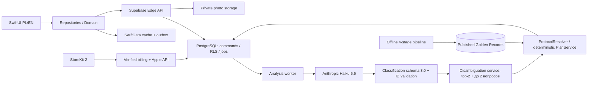

# Implementation Plan: Narat — iOS MVP, PL/EN

## Приоритет 2026-11-06 — развитие каталога по действиям

Исходная база — 606 видов с фото, описаниями и сезонными данными полива. T148–T151 ведут каталог в приложение. Обычный уход развивается отдельными партиями проверенных фактов; ближайший пробел — критерий готовности к поливу. Короткий опрос дополняет условия экземпляра; повторная диагностика использует журнал без вопросов. Цели и примеры приёмки — [спецификация](spec.md).

> **Синхронизация 2026-11-01:** технический дизайн приведён к спецификации Narat
> от 2026-10-30 и конституции 3.0.0: 68 FR, 25 SC, 9 историй.
> Части реализации, база и гостевой каталог на стенде проверены. Полная приёмка сценариев остаётся открытой.

**Branch**: `main` | **Date**: 2026-11-01 | **Spec**: [spec.md](spec.md)

**Input**: `specs/001-plants-ios-mvp/spec.md`, включая Session 2026-10-30, 68 FR / 25 SC; конституция v3.0.0.
Spec Kit resolver использует логическое имя `001-plants-ios-mvp`; фактическая Git-ветка
остаётся `main`, новая ветка этим планированием не создавалась.

**Status**: пересмотр 2026-11-07. Дизайн задаётся спецификацией от 2026-11-06. Есть SQL/клиентские компоненты, narat-staging и тестовая сборка на iPhone. Реальный каталог проверен на трёх карточках, коллекция и анализ ещё не соединены сквозным сценарием. Статусы и приёмка — tasks.md и docs/handoff_status.md.

## Summary

Нативное iPhone-приложение на SwiftUI с выбором намерения: помощь при проблеме
или персональный обычный уход. Первая помощь — по фото и трём вопросам.
Общие разделы — коллекция, дневник и задачи. UI и новые результаты поддерживают PL/EN;
по одному успешному стартовому identification и diagnosis доступны до входа; далее Free-аккаунту доступен один общий анализ в месяц UTC по FR-065.
Ветка ухода: определение вида сканом либо каталог → подтверждение вида → сохранение; базовый каталог допускает сохранение без опроса. При настройке ухода три вопроса дополняют условия экземпляра → бесплатный базовый уход либо выбор тройки; расширение предлагается по запросу. Каталог
не требует фото; identification не запускает диагноз. Базовый уход бесплатен для трёх выбранных растений; первая помощь с одним контролем не занимает место. Новые расширенные задачи требуют paid access.
Оба тарифа и подписочный trial дают 100 успешных фотоанализов в месяц от первого предоставления доступа. Основная модель —
Claude Haiku 5.5 через защищённый серверный адаптер.

SwiftData обеспечивает кеш и outbox; Supabase PostgreSQL хранит подтверждённые данные.
Одна серверная команда атомарно меняет уход, задачи и объяснения расписания.
Общий ScheduleCalculator реализуется в PostgreSQL в foundation и вызывается из
транзакций планов/ухода; Edge не держит второй независимый алгоритм.
Ранее полученные полные планы читаются после expiry с проверкой применимости; StoreKit-подписка подтверждается
сервером. Каталог и протоколы — 606 карточек с независимо публикуемыми фактами и 40 протоколов диагностики: четыре офлайн-этапа
в [knowledge-base-pipeline.md](knowledge-base-pipeline.md). Vision только классифицирует;
первая помощь и оба типа планов собираются из базы. Полный список решений — [research.md](research.md).

## Technical Context

**Language/Version**: Swift 6 language mode; TypeScript 5+ в Deno-compatible Supabase
Edge Runtime; SQL/PostgreSQL. Точные версии пакетов фиксируются SPM/deno lockfiles
после ранней проверки совместимости, затем меняются явно.

**Primary Dependencies**: SwiftUI, Observation, SwiftData, PhotosPicker/PhotoKit,
AVFoundation, AuthenticationServices, GoogleSignIn, Supabase Swift, StoreKit 2,
UserNotifications; сервер — supabase-js, официальный Anthropic SDK,
официальная Apple App Store Server Library, JSON Schema validator.

**Storage**: PostgreSQL + RLS; приватный Supabase Storage для личных фото;
SwiftData на устройство/аккаунт; Keychain для auth и claim proof. Платные тексты
и бесплатные проекции разделены. Тяжёлые изображения не включаются в delta-синхронизацию.

**Testing**: Swift Testing, XCUITest, Deno tests, pgTAP, StoreKit Testing + Sandbox;
reference-based оценка диагностики PL/EN без обязательного специалиста и физический camera prototype.

**Target Platform**: iPhone, iOS 17+. На текущем Mac проверен Xcode 26.3 (17C529).
Доступ к CoreSimulatorService в этой сессии не подтверждён; runtimes и устройства
проверяются перед первой сборкой. Камера и вход Apple проверяются также на реальном устройстве.

**Project Type**: mobile app + backend API; один репозиторий и один iOS target
с feature folders, без отдельных микросервисов на каждую функцию.

**Performance Goals**: SC-002 — минимум 95/100 анализов до 30 секунд при заданных
в спецификации условиях; явное завершение/ошибка к 60 секундам. Новый пользователь
получает бесплатную помощь за 3 минуты; основные исправления — до 60 секунд.
Численные критерии качества — SC-003/004 отдельно для PL/EN, без заявления о текущей точности.

**Constraints**: три базовых вопроса об уходе; после diagnosis/follow_up при low confidence/близкой паре — до двух вопросов Да/Нет из ConditionProfile;
определение вида выполняется до вопросов и не требует сведений об условиях; вход перед сохранением
в постоянную коллекцию; каталог допускает создание без фото/анализа; читаемые исходники любого размера
нормализуются/сжимаются на устройстве до загрузки (облачный вариант <=10 МБ).
После server TTL 24ч сохранение использует GuestDraftCache и проверяемый receipt.
Starter identification=1 и diagnosis=1 раздельны; Free monthly=1 со следующего UTC-месяца после первого starter success. Paid/trial monthly=100 от первого доступа; Free не суммируется с paid. Технические ошибки не расходуют успешную попытку.
Без сети — ранее загруженные доступные данные и устойчивые отметки ухода.
Никаких клиентских AI/server secrets. Модель и стек соответствуют конституции.
Safety cat/dog входит в Golden Records с evidence/unknown; FR-034 остаётся в MVP,
но требует физического прототипа до принятия этой функции.

**Scale/Scope**: 9 stories, 68 FR, 25 SC; 606 видов каталога, охват обычного ухода по SC-016 и 40 канонических проблем, два языка,
два периода подписки. Начальная конфигурация — до 10 одновременно выполняемых
AI-заданий на проект с контролем очереди и бюджета. Это параметр пилота, не обещанная
нагрузочная ёмкость; рост определяется latency/cost измерениями и квотами провайдера.

## Constitution Check

Gate повторно проверен 2026-11-01 по конституции 3.0.0 до и после синхронизации. PASS означает
соответствие дизайна, а не выполнение будущих release tests.

| Правило | До Phase 0 | После Phase 1 | Обеспечение в дизайне |
| --- | --- | --- | --- |
| I: PL/EN и короткий бесплатный путь | PASS | PASS | guest flow, 3 вопроса, locale snapshot; FR-001–007/045/049/050 |
| II: объяснимая неопределённость | PASS | PASS | schema + business validation + reviewed sources + eval; FR-005/006/019/044 |
| III: непрерывность экземпляра | PASS | PASS | стабильный plant UUID, immutable snapshots, care entries/reversals; FR-026–032 |
| IV: надёжные действия и задачи | PASS | PASS | durable outbox, receipts, транзакционный schedule; FR-024–030 |
| V: прозрачная подписка | PASS | PASS | раздельные starter/Free квоты, Free-тройка/контроль, чтение истории планов, voluntary trial; FR-015–023/065/066 |
| Закреплённый стек и секреты | PASS | PASS | Swift/SwiftData/Supabase/Haiku 5.5, приватные медиа, RLS; FR-041 |
| Проверяемые требования | PASS | PASS | spec, data model, contracts, quickstart; SC-001–025 |

Эта таблица относится к оценке дизайна 2026-11-01. Сверка реализации 2026-11-07 выявила нарушения, перечисленные в отчёте; их устранение предусмотрено T152 и переоткрытыми задачами. Техническое согласование версии каталога для независимого identification выполняется в T153. Проверки выполнимости и внешние credentials явно
указаны ниже как зависимости реализации и выпуска. Порог близости 0.10 и вес ответа 0.15 —
стартовые версионируемые допущения, проверяемые eval, не доказанная вероятность.

## Project Structure

### Documentation (this feature)

```text
specs/001-plants-ios-mvp/
├── spec.md
├── plan.md
├── research.md
├── knowledge-base-pipeline.md
├── data-model.md
├── quickstart.md
├── tasks.md
├── checklists/requirements.md
└── contracts/
    ├── api.md
    ├── sync.md
    ├── ai-result.schema.json
    ├── plant-profile.schema.json
    └── condition-profile.schema.json
```

[tasks.md](tasks.md) создан отдельным этапом `$speckit-tasks` после синхронизации дизайна;
статусы пересмотрены 2026-11-07 по полному объёму задач; частичные компоненты описаны в отчёте сверки.

### Source Code (repository root)

Ниже целевая структура; фактически созданные компоненты и отсутствующие части сверяются по задачам.

```text
ios/
├── Plants.xcodeproj
├── Plants/
│   ├── App/
│   ├── Features/{Onboarding,Analysis,Collection,PlantDetail,CareTasks,Paywall,Profile,ProgressReport}/
│   ├── Domain/{Care,Schedule,Entitlements,AnalysisAccess,Catalogue}/
│   ├── Data/{Local,Remote,Sync}/
│   ├── Integrations/{Auth,Camera,Photos,StoreKit,Notifications}/
│   └── Resources/{Localizable.xcstrings,Assets.xcassets}/
├── PlantsTests/
├── PlantsUITests/
└── Configuration/StoreKit.storekit
supabase/
├── config.toml
├── migrations/
├── tests/
└── functions/
    ├── plants-api/
    ├── analysis-worker/
    ├── billing-webhook/
    ├── maintenance/
    └── _shared/
catalogue/{manifests,editorial,licenses}/
knowledge-base/{pipeline,manifests,raw,staging,releases,tests}/
evals/{cases,expected,reports}/
```

**Structure Decision**: feature folders в одном клиентском target;
чистые Domain-операции не зависят от UI/SDK. Репозитории обслуживают кеш и запросы;
SwiftData access сериализуется ModelActor, UI state — MainActor. Сервер имеет
единый versioned client API и отдельные internal workers/webhook по границам доверия.

## Phase 0 — Research Results

Выбраны решения R01–R20 из [research.md](research.md):

1. SwiftData + явная синхронизация с PostgreSQL, без CloudKit.
2. Командные транзакции и устойчивые operation IDs вместо нескольких клиентских writes.
3. Native Apple/Google + безопасный claim гостевого результата, без предположения об auto-link.
4. StoreKit + server ownership/verification + Notifications V2.
5. Direct Haiku 5.5 structured output 3.0 только для классификации; советы из Golden Records.
6. Durable jobs и bounded worker; идемпотентная публикация, без обещания exactly-once billing.
7. Четыре offline stages: seed/taxonomy → разрешённые доноры Markdown → LLM synthesis/guardrails → EN/PL + mapping PL; без обязательного специалиста.
8. Необязательная qualitative camera hint с ручным подтверждением, без lux обещаний.
9. Starter ID/diagnosis и Free/Paid monthly: installation_access + profiles + monthly_quotas, резерв в job, атомарный bind без повторной выдачи; provider budget отдельно.
10. Basic/full routine и recovery из базы без LLM/фотоквоты; access_class задач и сохранённое чтение полных планов.
11. Progress Report из журнала, owner/month notification claim и аналитика Free→Trial→Paid с фактическими затратами.

## Phase 1 — Architecture and Data Flows



### Намерение и маршрутизация

Welcome и новое добавление используют общий AddPlantRouter с intent=problem/care,
отдельным add_method=scan/catalogue и устойчивым flow_id. Выбор можно изменить без
автоматического AI-запроса; совместимые фото/ответы сохраняются. Повторный запуск
после приветствия ведёт на Today. Обе ветки включены в MVP, автоматического отключения нет.
Роутер отделён от Analysis/Collection/Plan, чтобы будущее скрытие входа не стирало историю
и не мешало открывать уже сохранённые растения. Маршрут — [user-flow.md](user-flow.md).

### Диагностика и сохранение

Guest session создаётся технически без регистрации. Фото нормализуется на устройстве,
загружается в приватный Storage; три ответа фиксируются snapshot. Короткий POST создаёт
job и резерв в installation_access/profiles либо monthly_quotas одной транзакцией, UI опрашивает статус. Worker проверяет владельца,
право доступа, резерв job, provider_daily_budget и входные данные,
отправляет Haiku фото, подтверждённый контекст и закрытые ID из pinned KB release.
Ответ содержит только классификацию и наблюдения; проходит схему 3.0 и проверку ID.
ProtocolResolver выбирает опубликованную первую помощь/объяснение с проверкой применимости.
Полный протокол не включается в бесплатную проекцию.
Публикация результата и расход ровно одной выбранной попытки атомарны. До входа доступны starter каждого режима; после — Free monthly либо paid_monthly. Follow_up всегда требует paid access.
`GET /analysis-access` возвращает остаток, running reservations и дату обновления.
Все запросы на анализ используют installation credential из Keychain; после входа
его привязка к аккаунту выполняется до новых jobs. Старый guest credential служит
только для claim. Установка/аккаунт не получают новую попытку при logout/claim/expiry.
До обязательного входа нельзя гарантированно распознать одного человека на разных
устройствах; ограничения частоты и проектного бюджета ограничивают этот риск.
Подробные инварианты периода и конкурентного учёта — R14 и API contract.

После Apple/Google входа claim переносит именно этот результат, не всю чужую anonymous
сессию. Storage copy и публикация имеют явные состояния. Повторное сохранение не
создаёт второй экземпляр; разные экземпляры одного вида допустимы. Claim разрешён
для завершённого успешного результата; расход стартовых попыток переносится как факт, без повторного
списания и без дополнительной бесплатной попытки. Незаявленный draft очищается через
24 часа, маркер использованной попытки не удаляется вместе с draft. GuestDraftCache хранит
фото/ответы/результат и подписанную analysis_receipt до подтверждённого сохранения/явного отказа.
После TTL plant.create проверяет receipt, восстанавливает доступные данные без нового ИИ/квоты;
origin_draft_id дедуплицирует claim/fallback. Неполный кеш явно объясняется, не подделывает диагноз.

Перед сохранением PreSaveReview показывает фото/вид/условия и необязательную комнату.
Overrides вида/условий создают snapshot версии 2, care_revision=2 и stale исходный анализ;
смена только комнаты не меняет AI-контекст. LightSource и light_confirmed отделяют manual,
camera_estimate и unknown. Ответ содержит next_available_step; проверка не задерживает
бесплатную помощь и не запускает скрыто повторный анализ или платный план.

Альтернативный путь: вошедший пользователь выбирает published taxon, необязательные
собственное фото/комнату и сохраняет экземпляр без анализа. Карточка без фото или
истории анализа показывает явное пустое состояние, а не выдуманный диагноз.

### Уход через скан и каталог

Ветка care вызывает mode=identification по одному фото, без обязательных ответов;
исходный snapshot содержит unknown. Ответ Vision схемы 3.0 содержит plant_id/статус,
diagnosis/comparison = null; first_action/full_plan в provider schema отсутствуют.
Названия PL/EN и неопределённость UI берёт из релиза/локализованных codes. Успешный пригодный результат
определения вида использует свой starter, затем общий Free monthly либо paid_monthly по текущему доступу. Непригодное
фото и технические ошибки не расходуют попытку; пригодный unknown обозначается честно.
Далее пользователь подтверждает вид и отвечает на три вопроса. Claim/fallback переносит
receipt с режимом результата и overrides условий без повторного скана. Для care plan_source=catalogue
означает источник правил, даже когда creation_source=identification; подтверждённый вид
и текущие условия определяют детерминированный персональный план без LLM/фотоквоты.
Если профиль отсутствует, UI объясняет это до предложения покупки ради данного плана.

### Измерение намерений

FunnelService принимает только фиксированные этапы без фото и свободного текста;
flow_id сохраняется при возврате и входе. Выбор/смена намерения, метод, завершение вида/результата,
сохранение, предложение, новая подтверждённая покупка и готовый план учитываются отдельно.
Сохранение/покупку/план пишет сервер после подтверждённого результата; restore не новая покупка.
Доли первого выбора и конверсии считаются по flow_id и намерению на этапе, переключения
показаны отдельно; это аналитика сценариев добавления, а не уникальных людей между устройствами.

### Полный план, Free-уход и состояние доступа

StoreKit products дают фактические локализованные цены: PL month 49,99 zł без trial,
year 199,99 zł с добровольным 7-дневным trial только eligible. Сервер проверяет ownership,
JWS/status и фактически предоставленный offer_kind; active/grace, включая trial, даёт paid access.
Restore не переносит покупку между аккаунтами и не сбрасывает квоту. Opt-in reminder за 24ч
использует подтверждённый trial_end_at; дата видна без уведомлений, доставка не гарантируется.

PlanService формирует routine (catalogue) и recovery (analysis) из Golden Records без LLM/квоты.
access_tier=full требует paid access на admission/commit; basic routine создаётся по явному включению
базового ухода в пределах Free-мест или без лимита при paid. Нет профиля/применимого решения —
reason до предложения покупки; stale переоценивается по сохранённым наблюдениям, care_revision
до commit защищает актуальность. Публикация plan/rules/первых tasks атомарна.

basic_care_memberships хранит enabled_at и free_slot 1..3. Подписка не стирает выбранную тройку;
expiry сохраняет выбор либо первые три включённых. Снятие места при Free приостанавливает basic rules
и их reminders, сохраняя задачи/историю. Basic обновляется бесплатно; full routine не дублирует
условные проверки полива. Первый уход с неизвестной историей — check_soil_first.

Первая помощь и один контроль имеют отдельную связь first_aid_followups, не требуют места/full plan.
Отметка создаёт контроль по опубликованному сроку, наблюдение/фото сохраняются без AI. Начало полного
лечения согласует выполненное первое действие с timeline, не предлагает повторить его автоматически.
Переход recovery→basic требует текущего наблюдения/применимости и явного подтверждения; completion
не означает выздоровление. Пустой день/возврат после перерыва не добавляет фиктивных фактов.

Ранее опубликованные личные планы (включая trial) доступны для чтения после expiry/refund через
owner API и PlanHistoryCache с датой/версией/applicability. Неприменимые/отозванные инструкции
блокируются независимо от подписки; новые full планы и premium occurrences требуют paid access.
Короткая task projection не открывает полный KB. Исчерпание 100 не закрывает прочие оплаченные функции.

Paywall — только по запросу платного расширения после бесплатной пользы. RequestedAction сохраняет
контекст; успешная покупка возвращает к нему с повторной проверкой, отмена — к Free следующему шагу.
Повторный запуск не показывает обязательный paywall; старт лечения остаётся явным.

### Progress Report и продуктовые метрики

Бесплатный ProgressReportService строит итог завершённого местного месяца по фактам журнала,
исправлениям/отменам, фото и наблюдениям; текущие ближайшие задачи вынесены отдельно. ReportCache (owner/month/timezone/locale)
инвалидируется owner watermark, отсутствие данных обозначается; нет AI или оценки здоровья.
UserNotifications планирует добровольное уведомление, server claim owner+YYYY-MM без timezone
исключает повтор между устройствами; отчёт доступен при открытии без уведомления.

FunnelService расширен событиями Free/Trial/Paid, отказа/возврата, первой задачи, скана Free и отчёта.
Billing facts подтверждаются сервером, provider usage/cost включает ошибки. Сервисная аналитика
отделена от пользовательского отчёта: когорты/D7/D30/продление с полными окнами и знаменателями,
раздельная выручка/возвраты/стоимость, без заявления LTV по выручке за 30 дней.

### Уход, конфликты и объяснения

Outbox сохраняет факт намерения до отправки. Одна серверная транзакция записывает
care entry или reversal, пересчитывает задачи и записывает schedule reason.
Отдельные revision и care_revision защищают обычные изменения и контекст AI.
Care.record/care.undo принимаются без отказа по старой revision и без блокирующих
диалогов, пока растение не удалено; отдельный patch свойств объединяется по полям.
Дата выполнения — фактическая; более ранний уход не переносит расписание поверх
более позднего действия. Неприменимый план помечает незавершённые задачи needs_review: выполнение в один тап
и нейтральные напоминания доступны, старый уход не выдаётся за актуальный, новые
occurrences по неприменимым правилам не создаются до обновления плана.
Пересчёт разделяет обновление существующего occurrence и вставку нового: INSERT
проверяет access_class и актуальную применимость, включая workers/offline replay: basic_care — Free-место/paid access, first_aid_control — один бесплатный контроль, premium — paid access. Политика
проверяется по серверному времени при commit. Короткий task snapshot не раскрывает
платный план. Прогноз next_check без права на новую задачу не создаёт task/reminder.

### Простая синхронизация и квоты

Operation_receipts сохраняет идемпотентный результат команды; прямые delta-запросы
используют updated_at/deleted_at, since/until и стабильную пагинацию. Writer/reader
сериализуются профилем владельца и монотонной меткой времени: поздний commit не теряется.
Tombstones живут до удаления аккаунта; полный refresh не стирает LocalOutbox.
Отдельных таблиц ленты/голов синхронизации и event-sourcing нет.

Квоты: installation_access, monthly_quotas (free_monthly/paid_monthly), provider_daily_budget. Два starter-маркера аккаунта хранятся в profiles, резерв принадлежит analysis_jobs. Короткие SELECT ... FOR UPDATE защищают
admission/commit/release и OR при bind; сеть не выполняется под row lock. Якорь периода
фиксируется от первого paid/trial access; Free использует UTC-календарь. Running job остаётся в исходном источнике/месяце. Детали — R14 и data-model.md.

### Языки и справочник

PL/EN UI, локализованные error/action codes и уведомления; английский fallback
при отсутствии поддерживаемого предпочтения. Язык анализа фиксируется при запуске,
история не переводится автоматически. Каталог ищется по PL/EN/Latin synonyms;
научное имя заменяет отсутствующее достоверное обиходное название.

Golden Records публикуются после проверки источников/прав, схем, guardrails и EN/PL.
Runtime модель получает только классификационные ID, не полномочия создавать советы/товары.
Safety ASPCA cat/dog хранится с evidence, null/unknown не интерпретируется как безопасность.
Коэффициенты/FC/рецепты из исходного примера — не готовые данные; неизвестные не выдумываются.

Напоминания используют reminder_hour_local (INT 0..23, default 9) и timezone устройства.
Профиль меняет час; ReminderScheduler перестраивает будущие уведомления без дублей,
включая существующие needs_review. Первый water при неизвестной истории требует
check_soil_first, а не безусловный полив сразу после добавления.

### Contracts

- [knowledge-base-pipeline.md](knowledge-base-pipeline.md): offline/runtime, доноры, guardrails и KB gates.
- [data-model.md](data-model.md): сущности, состояния, constraints и доступ.
- [contracts/api.md](contracts/api.md): endpoints, requests, errors, guest claim и billing.
- [contracts/sync.md](contracts/sync.md): offline, receipts, cursors и конфликты.
- [contracts/ai-result.schema.json](contracts/ai-result.schema.json): ответ провайдера.
- [quickstart.md](quickstart.md): подготовка окружения и проверяемые сценарии.

## Validation and Release Gates

| Gate | Что нужно доказать до соответствующего этапа | Текущее состояние |
| --- | --- | --- |
| G01 Environment | Xcode/toolchain lock, simulator + физические поддерживаемые iPhone | Xcode прочитан; simulator недоступен в этой сессии |
| G02 SDK/runtime | Anthropic и Apple verifier в точном Edge Runtime, negative signatures/OCSP | Не запускалось; до live payments/AI |
| G03 Camera | стабильные qualitative hints на младшем/старшем iPhone, unknown вместо ложной оценки | Не запускалось; до приёмки FR-034 |
| G04 Data | KB01–07: факты по действиям и охват по SC-016, 40 протоколов, права доноров, provenance, схемы/guardrails, PL/EN, safety, разрешения товаров | 606 карточек проверены локально; приёмка фактов для рекомендаций открыта |
| G05 AI | SC-002–004 отдельно PL/EN до/после уточнения (T125), максимум задержки и фактический usage | Выборка/измерения ещё не подготовлены |
| G06 Care/sync | повтор, crash, offline replay, undo, backdate, cursor reset; access_class/Free-места, чтение истории планов и права premium | Ожидает реализации |
| G07 Billing/auth | sandbox restore, grace/expiry/refund, owner conflict, native sign-in/claim; starter ID/diagnosis, Free=1/Paid=100, trial→paid без reset, concurrency | Внешние аккаунты/ключи не настроены этой работой |
| G08 End-to-end | SC-001/005–025, V01–V56, оба языка, private photos, account deletion, Free/trial/report | Ожидает реализации |

Выпуск невозможен при провале обязательного gate. Непригодный camera prototype
или несовместимый Apple verifier требуют исправления дизайна/согласованной поправки,
а не молчаливого исключения FR-034 или отключения проверки подписей.

## Implementation Sequence

Порядок пересмотрен 2026-11-07 по spec.md. Подробные критерии и зависимости — в начале tasks.md.

1. T152: устранить фиктивный диагноз/квитанцию/коммит и пустой экран до следующей передачи сборки.
2. T148: завершить редакционную приёмку базовых 606 карточек EN/PL и фотографий.
3. T149: каталог → постоянный вход → сохранение экземпляра → чтение после перезапуска, без обязательных фото, опроса и полной KB. Завершить необходимые части API/auth/commands/sync/collection, проверить повтор и владельцев.
4. T153 → T150: определить вид по реальному фото по опубликованному каталогу; подтвердить/исправить, сохранить личное фото и экземпляр. Полный набор 40 проблем и care profiles не является prerequisite этого среза.
5. T151/T154: закончить приёмку каталога и инфраструктурных изменений на EN/PL, с отдельными результатами fixtures/live и физического iPhone.
6. T108–T115/T021: публиковать независимые проверенные факты ухода, начиная с критерия полива. T055/T117/T129–T131 обеспечивают применимость конкретного действия и бесплатный уход до трёх растений.
7. ConditionProfile/T120 и опубликованные диагностические данные → полноценный US1, T116/T121/T122/T125; первая диагностика с допустимыми уточнениями, повторная — по истории без вопросов.
8. Полные планы/StoreKit → ежедневные задачи → дневник/правки → напоминания/профиль/контроль → отчёты и аналитика. Все истории и release gates сохраняются.

Внешние зависимости подключаются до нужного среза: постоянный Apple/Google вход для T149, приватный Storage и рабочий provider для T150, покупки для US3. Personal Team служит для device-тестов. Фактическая доступность ключей/модели и опубликованных данных проверяется отдельно; наличие шаблона настройки этого не подтверждает.

Три вопроса первого добавления должны соответствовать FR-004 (свет, привычный полив, дренаж). Для базового каталога T149 вопросы не обязательны. Условия повторной диагностики берутся из экземпляра и журнала, включая отмены и исправления. Старые last_watered-поля мигрировать явно, не переименовывать их значения в дренаж.

## Requirement Coverage

| Требования | Решение / контракт |
| --- | --- |
| FR-001–FR-007 | R07/08/11/14, раздельные starter, AnalysisRequest + PreliminaryAnalysis |
| FR-008–FR-014 | R03/04/09/14/15, claim + rooms/plants commands, каталог без фото |
| FR-015–FR-021 | R05/06/14/15, billing, FullPlan/entitlement, 100 monthly + analysis-access |
| FR-022–FR-030 | R02/16/20, ScheduleCalculator, access_class/Free-места + sync.md |
| FR-031–FR-034 | R01/03/12, plant.edit/photo.set_main и camera prototype |
| FR-035–FR-038 | R08/11/14, local notifications + metered follow_up jobs |
| FR-039–FR-041 | R03/04/05, profile + deletion + owner policies |
| FR-042–FR-044 | R09/10, versioned catalogue + reviewed evidence |
| FR-045 | R11, locale snapshot, local preference и неизменяемая история |
| FR-046–FR-048 | R04/12/15, PreSaveReview, overrides/snapshot/stale, LightSource, next_available_step, TTL fallback |
| FR-052–FR-064 / SC-016–SC-020 | R18, knowledge-base-pipeline.md, classification 3.0 / Golden Record schemas 1.0, T108–T126, V33–V43 |
| FR-049–FR-051 | R17/20, intent/router, Free/Trial/Paid funnel, подтверждённые billing/usage facts |
| FR-065–FR-068 / SC-021–SC-025 | R14/16/20, data-model §§4/9/10, API §§10/11, V44–V56, задачи Narat |
| SC-012 | выбор двух путей и каталожное добавление без фото/комнаты за 90с; usability PL/EN |
| SC-013 | понимание первого действия/основания и срока/признака проверки; usability PL/EN |
| SC-014 | различение camera_estimate/unknown, явное подтверждение, overrides, stale plan без квоты и TTL fallback |

## Complexity Tracking

Конституционных исключений нет. Надёжная очередь, operation_receipts и отдельная
платная проекция необходимы для FR-020/024/025/028/041; дополнительный standalone
backend, отдельная клиентская БД и инфраструктура push-сервера в MVP не вводятся.
Safety встроена в профиль Golden Record. Три таблицы квот, job markers и прямые delta-запросы
заменяют дублирующие слои. История ухода сохраняется в обычных таблицах, не как event-sourced aggregate.

## Поправка 2026-10-25 — реализация KB

Offline scripts выполняются вне пользовательского request path и имеют отдельные
credentials/бюджет. Stage 1–4 описаны в [модуле](knowledge-base-pipeline.md), выбранный
язык скриптов — Python/Pydantic с каноническими JSON Schema; это инструмент подготовки,
не новый production backend. SQL остаётся единственным автором расписания.
Каждая партия публикует независимо проверенные факты с правами и provenance. Для итогового выпуска охват оценивается отдельно по SC-016.
Прежний AI-generated FullPlan удалён из provider schema; клиентские DTO PreliminaryAnalysis
и FullPlan формируются backend из базы и сохраняют бизнес-поля, release/protocol IDs.
Точная схема провайдера проверяется G02 отдельно; этот документ не подтверждает SDK compatibility.

## Дополнение полным промптом — ConditionProfile и уточнение

Offline synthesis теперь выпускает канонический ConditionProfile с visual_markers,
diagnostic_disambiguation (вопросы EN/PL) и treatment_plan.steps. Новый контракт
Vision 3.0 возвращает не более двух кандидатов с confidence; генерировать вопросы
модель не должна. DisambiguationService сравнивает пороги из kb_releases.policy
(top1<0.80 или gap<0.10), выбирает до двух вопросов и перерасчитывает scores без LLM.
При неопределённости выбирается fallback; confidence не показывается как вероятность.

Готовый фотоанализ с безопасной первой помощью завершает job/квоту до ожидания
ответов. Diagnostic decisions/answers версионируются отдельно, подписываются,
переносятся claim/fallback и не переписывают исходную классификацию.
Recovery plan ссылается на применимое решение; диагноз не уточнён — diagnosis_unresolved.

Condition snapshots дополнены необязательными pot_type и season_override в тех же
экранах онбординга; четвёртого обязательного вопроса нет, отопление не угадывается.
ScheduleCalculator разворачивает ограниченный timeline treatment steps (start offset,
interval, total repeat_count, phase), проверяет актуальность PL применения и не смешивает
альтернативные вещества/энтомофагов. Поддерживаются isolate/wash_pests/treat_pests;
материализация ближайшего occurrence и граница premium INSERT сохраняются; basic/first_aid_control проверяют собственные бесплатные права.
Новые tasks T120–T126 и проверки V40–V43 / KB08–KB10 обязательны до выпуска.

## Порядок внедрения поправки Narat

Существующие T001–T126 сохраняют ID, но изменённые правила обновлены непосредственно в задачах.
Новые задачи Narat размещены по историям; порядок определяется явными prerequisites, не поздними ID.
Сначала schema/access_class/квоты/Free-места и DTO; затем существующие stories вместе с их Free-путями;
после них US9/расширенная аналитика; общая приёмка охватывает V01–V56 и NR-A1–10.
Минимальный внутренний срез — диагностика→сохранение→первая помощь/контроль и catalogue→basic care.
Выпуск MVP требует все 9 историй P1/P2, 68 FR/25 SC и G01–G08/KB01–KB10.

Реальных миграций/развёрнутых данных в репозитории нет. Это несовместимая правка draft-контрактов
до первого кода: installation_trials→installation_access, раздельные starter/месячные ledgers,
access_class и PlanHistoryCache. При обнаружении deployment сначала inventory/backup и отдельный
backfill без потери расхода/истории; production migration этим документом не разрешается и не заявляется.
Provider schema 3.0 и Golden Records 1.0 сохраняются: новые права/отчёт — backend DTO.

Локальная проверка 2026-11-01: Xcode 26.3 (17C529) доступен; Simulator не подключился в sandbox
этой сессии; Docker/Supabase CLI/Deno не найдены в PATH. Это задачи T001/G01, не доказательство
отсутствия внешних аккаунтов. SDK/model availability, credentials, данные и качество остаются gates
реализации; документационная синхронизация не закрывает их.
